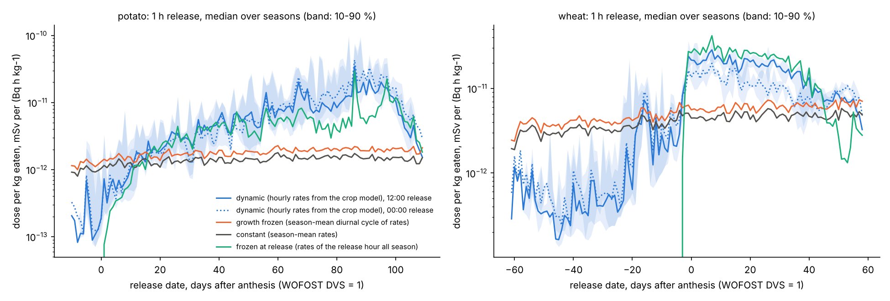
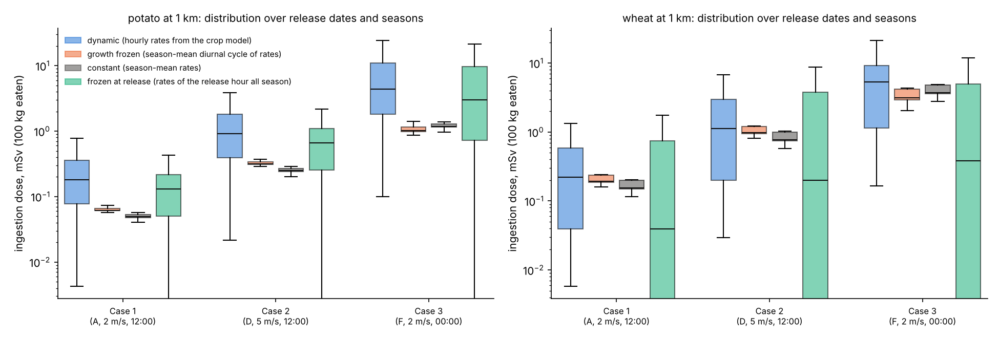
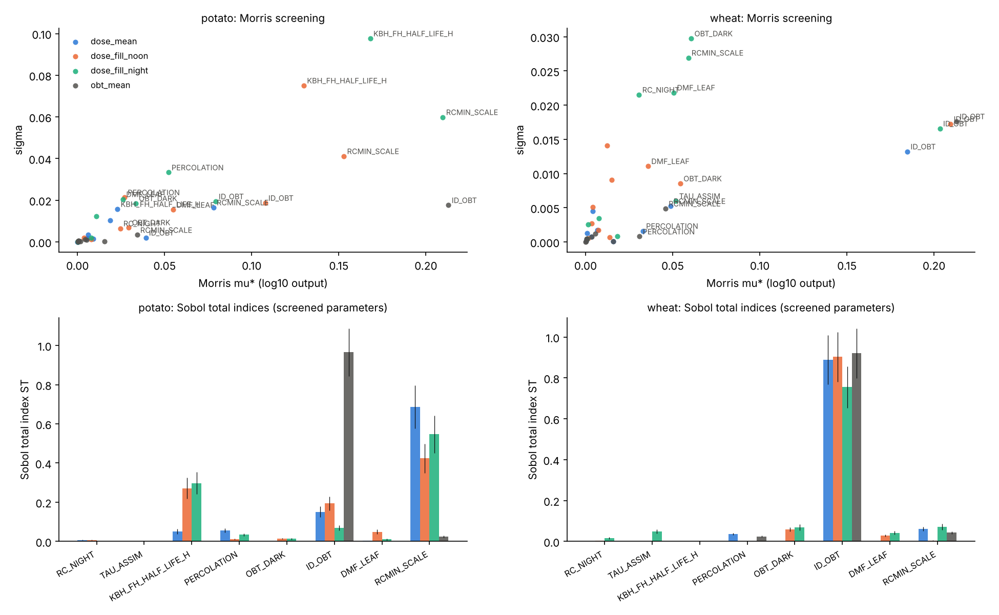

# 论文分析：动态迁移率、释放日期、假想事故情景与敏感性分析

本目录是交接说明第 7 节的 B 项。**所有结果对应模型 commit `4e09ac5`**：本目录和 `validation/supplementary_chamber.py`
都没有修改 `dmitte/`，`git log -- dmitte/` 的最新提交仍是 `4e09ac5`，与测试集运行（`validation/README.md` 第 4.6 节）用的是同一版模型。

```
analysis/
├── common.py            # 生长季、冻结迁移率的基线、释放响应（伴随法）
├── release_dates.py     # B1 动态 vs 常数迁移率 + 释放日期扫描（约 1 分钟）
├── emras_scenarios.py   # B2 假想事故释放 Case 1/2/3（约 1 分钟）
├── sensitivity.py       # B3 Morris 筛选 → Sobol 指数（4 核约 30 分钟）
└── results/             # CSV、标准输出、figures/
```

```bash
python validation/build_inputs.py      # 先生成 ./data
python analysis/release_dates.py | tee analysis/results/release_dates_stdout.txt
python analysis/emras_scenarios.py | tee analysis/results/emras_scenarios_stdout.txt
OMP_NUM_THREADS=1 python analysis/sensitivity.py --jobs 4 | tee analysis/results/sensitivity_stdout.txt
python -m pytest tests/test_analysis.py   # 伴随法 = 正向计算、叠加原理、冻结基线
```

## 1 共同设定

- 与验证相同：Wageningen 逐时气象（含日变化），WOFOST 马铃薯 2004–2008、冬小麦 2005–2008，空气水汽 HTO 作为边界条件。
- **释放响应**：在第 j 小时施加 1 h、空气水汽 HTO 1 Bq/kg 的暴露（时间积分浓度 1 Bq·h/kg），计算收获时可食部分的
  OBT（Bq/kg 燃烧水）、TFWT、鲜重总氚（Bq/kg 鲜重）和成人食入剂量（mSv/kg 食用量，ICRP-72）。模型对空气浓度是线性的，
  所以一次反向（伴随）递推就得到整季每个小时释放的响应，任意空气时间过程的结果是逐时响应的叠加（`tests/test_analysis.py` 验证与正向计算一致）。
  只统计出苗到成熟（WOFOST 0 ≤ DVS < 2）之间的释放。
- **基线（同一模型，只去掉时间变化，不用 UFOTRI）**：

| 名称 | 迁移率 | 代表 |
|---|---|---|
| dynamic | 作物模型驱动的逐时迁移率 | 本模型 |
| diurnal_only | 每个钟点取整季同一钟点的平均：保留日变化，冻结作物生长 | 只有日变化的模型 |
| constant | 整季平均，无日变化和季节变化 | 参数固定的静态模型 |
| release_frozen | 释放那一小时的迁移率一直用到收获 | 用释放时刻条件计算的准静态模型 |

  浓度换算都用实际的收获期库容（产量、含水），所以差别只来自迁移率的时间变化。

## 2 B1 动态 vs 常数迁移率、释放日期扫描

每天 00:00 和 12:00 的释放，4–5 季中位数。剂量单位 mSv/kg 食用量 /（Bq·h/kg）。

| 作物 | 基线 | 季均剂量 | 季内最大 | 95 %/5 % 分位比 | 正午/午夜 | 季均 / dynamic | 最大 / dynamic |
|---|---|---|---|---|---|---|---|
| 马铃薯 | dynamic | 9.9e-12 | 8.9e-11 | 100 | 0.97 | 1 | 1 |
| | diurnal_only | 1.5e-12 | 2.7e-12 | 2.7 | 1.47 | 0.15 | 0.030 |
| | constant | 1.4e-12 | 2.1e-12 | 2.1 | 0.99 | 0.14 | 0.024 |
| | release_frozen | 6.1e-12 | 4.7e-11 | ∞（块茎形成前为 0） | 1.13 | 0.61 | 0.54 |
| 小麦 | dynamic | 8.2e-12 | 3.6e-11 | 92 | 1.02 | 1 | 1 |
| | diurnal_only | 4.3e-12 | 8.5e-12 | 3.0 | 1.51 | 0.53 | 0.24 |
| | constant | 4.1e-12 | 6.6e-12 | 2.2 | 1.00 | 0.50 | 0.19 |
| | release_frozen | 6.7e-12 | 5.2e-11 | ∞（开花前为 0） | 3.4 | 0.82 | 1.45 |

按开花后天数（WOFOST DVS = 1）分段的 dynamic / constant（`results/release_dates_stdout.txt`）：小麦开花前 0.1–0.2（常数模型高估 5–10 倍），
开花后 0–30 d 为 2.4–5（低估），之后逐渐回到 1.5–1.7；马铃薯 DVS 1 之前 0.1–0.5，之后从 1.4 一直升到 8–13（DVS 1 后 80–100 d）。



结论：
- **同样 1 h 的释放，收获期剂量随释放日期相差约 100 倍（5–95 %），常数迁移率只有约 2 倍。** 季内最坏情况常数模型低估 5 倍（小麦）到 40 倍（马铃薯），
  季均也低估 2–7 倍；在籽粒/块茎形成之前则高估一个数量级。这是论文“动态迁移率”的主要结果，与测试集中籽粒 TLI 随灌浆阶段的变化（B53–B55）一致。
- **差别几乎全部来自作物生长，不是日变化**：diurnal_only 与 constant 只差 1.0–1.3 倍。
- **冻结在释放时刻也不行**：籽粒/块茎还不存在时剂量为 0（实际经土壤和后来的根系吸收仍有贡献），灌浆期可高估（小麦最大 1.45 倍），
  正午/午夜比为 3.4，而动态模型约 1.0（夜间释放留在叶片里的 HTO 到第二天早上仍被光合固定）。
- 马铃薯后期的高剂量部分来自收获时块茎水中尚未交换出去的 HTO（鲜重总氚包含 TFWT）；只看 OBT 时 dynamic 的季内最大/中位数为 5（小麦 13）。

## 3 B2 假想事故释放（EMRAS TC14 第 9 章类型）

设定沿用仓库中 `iaea-case1-HTO.py`、`cereals_HTO.py`、`potato_HTO.py` 的参数：3.7e15 Bq HTO 在 1 h 内释放，有效高度 20 m，
烟羽轴线下风向 1、3、10、30 km；Case 1 稳定度 A、2 m/s，Case 2 D、5 m/s，Case 3 F、2 m/s。A 只出现在白天、F 只出现在夜间，
所以 Case 1、2 在 12:00 释放，Case 3 在 00:00。释放日期取每季出苗到成熟的每一天，结果是释放日期 × 生长季的分布。
剂量按全年吃 100 kg 该作物、全部来自该地点计算，只作比较用。

**与库室模型的耦合**（模型设计评审第 13、14 条）：烟团模型给出的 1 m 高度浓度逐小时积分，除以该小时的绝对湿度，作为大气库室的边界条件，
覆盖整个过境时间。不用初始库存、不强制在 1 h 后清零，也不用混合层高度或积分高度。Case 的稳定度只用于扩散；库室自身的大气参数
（RAM、沉积）整季都用站点逐时气象和中性稳定度（`run_validation.STABILITY = 4`），包括过境的几个小时。
局限：扩散用 Case 的风速，叶片交换用站点当时的风速；从土壤和植物再释放的 HTO 不回到大气（没有局地大气库室），这对 1 km 以外的结果是保守的低估。

1 km 处的年食入剂量（mSv），释放日期 × 生长季的 5 % / 中位数 / 95 % / 最大：

| 作物 | Case | dynamic | constant | release_frozen | constant 中位数 / dynamic | constant 最大 / dynamic |
|---|---|---|---|---|---|---|
| 马铃薯 | 1（A，12:00） | 0.014 / 0.18 / 0.97 / 3.9 | 0.043 / 0.049 / 0.056 / 0.058 | 0 / 0.13 / 0.63 / 1.7 | 0.27 | 0.015 |
| | 2（D，12:00） | 0.071 / 0.91 / 4.9 / 19 | 0.22 / 0.25 / 0.28 / 0.29 | 0 / 0.66 / 3.2 / 8.6 | 0.27 | 0.015 |
| | 3（F，00:00） | 0.33 / 4.4 / 29 / 99 | 1.0 / 1.2 / 1.4 / 1.4 | 0 / 3.0 / 17 / 36 | 0.27 | 0.014 |
| 小麦 | 1（A，12:00） | 0.013 / 0.22 / 1.0 / 1.7 | 0.13 / 0.15 / 0.20 / 0.20 | 0 / 0.040 / 1.3 / 2.8 | 0.69 | 0.12 |
| | 2（D，12:00） | 0.064 / 1.1 / 5.1 / 8.6 | 0.65 / 0.77 / 1.0 / 1.0 | 0 / 0.20 / 6.7 / 14 | 0.69 | 0.12 |
| | 3（F，00:00） | 0.38 / 5.4 / 18 / 31 | 3.1 / 3.7 / 4.9 / 4.9 | 0 / 0.38 / 9.8 / 15 | 0.69 | 0.16 |

3、10、30 km 的结果见 `results/emras_summary.csv`；距离只改变时间积分浓度，各基线之间的比值基本不变。



结论：同一释放，稳定度 F（夜间）比 A 高约 25 倍，主要来自地面浓度（时间积分浓度高 25 倍）。在同一个 Case 内，**释放日期造成的范围（5–95 % 约 70 倍）
比 Case 之间的差别还大**，而常数迁移率模型把这个范围压缩到 1.3–1.6 倍，最坏情况低估 7–70 倍。

## 4 B3 敏感性分析（Morris → Sobol）

输出（每种作物，各季几何平均，取 log10）：全季任意时刻释放的平均剂量 `dose_mean`、灌浆中期 12:00 释放 `dose_fill_noon`、
同日 00:00 释放 `dose_fill_night`、平均收获 OBT `obt_mean`。参数和范围见 `sensitivity.py` 文件头：RC_NIGHT 3–6、TAU_ASSIM 2–12 h、
KBH_FH 半衰期 20–200 h、PERCOLATION（constant/darcy）、OBT_DARK 0.1–0.5、ID_OBT 0.6–1.0、ALF_HTO 1.08–1.12、DMF_LEAF 0.15–0.25、
RCMIN 乘 0.5–1.5、KBO_BH 0–ln2/10 d。田间箱/舱室的空气动力学阻力只属于验证实验，不是田间情景的参数，没有纳入。

Morris（r = 20，每种作物 220 次）筛掉 ALF_HTO 和 KBO_BH（mu* 都低于最大值的 10 %），其余 8 个做 Sobol（N = 256，每种作物 2 560 次）。
Sobol 总指数 ST（`results/sobol.csv`）：

| 参数 | 马铃薯 dose_mean | fill_noon | fill_night | obt_mean | 小麦 dose_mean | fill_noon | fill_night | obt_mean |
|---|---|---|---|---|---|---|---|---|
| RCMIN 乘数 | **0.69** | **0.42** | **0.55** | 0.02 | 0.06 | 0.00 | 0.07 | 0.04 |
| ID_OBT | 0.15 | 0.19 | 0.07 | **0.97** | **0.89** | **0.90** | **0.76** | **0.92** |
| KBH_FH | 0.05 | 0.27 | 0.30 | 0.00 | 0.00 | 0.00 | 0.00 | 0.00 |
| PERCOLATION | 0.06 | 0.01 | 0.03 | 0.00 | 0.04 | 0.00 | 0.00 | 0.02 |
| OBT_DARK | 0.00 | 0.01 | 0.01 | 0.00 | 0.00 | 0.06 | 0.07 | 0.00 |
| TAU_ASSIM | 0.00 | 0.00 | 0.00 | 0.00 | 0.00 | 0.00 | 0.05 | 0.00 |
| DMF_LEAF | 0.00 | 0.05 | 0.01 | 0.00 | 0.00 | 0.03 | 0.04 | 0.00 |
| RC_NIGHT | 0.01 | 0.01 | 0.00 | 0.00 | 0.00 | 0.00 | 0.02 | 0.00 |
| 输出 95 %/5 % 比 | 1.24 | 1.71 | 1.95 | 1.59 | 1.52 | 1.62 | 1.68 | 1.62 |

S1 与 ST 几乎相等（参数之间交互很弱）。



结论：
- **参数不确定性造成的输出范围只有 1.2–2 倍**，远小于释放日期造成的约 100 倍和动态/常数迁移率之间 2–40 倍的差别。所以“迁移率随作物生长变化”
  这一结论不会被参数不确定性推翻。
- 小麦几乎完全由 OBT 生成的同位素歧视因子 ID_OBT 决定（文献值，0.6–1.0）；马铃薯剂量由最小气孔阻力（RCMIN）决定，灌浆期释放还取决于
  植物水 → 块茎水的交换（KBH_FH，基准无法区分，见交接说明），块茎 OBT 则由 ID_OBT 决定。
- **在校准集上标定的两个参数（RC_NIGHT、TAU_ASSIM）对剂量几乎没有影响**（ST ≤ 0.05），标定误差不会传到剂量。OBT_DARK 只影响小麦灌浆期释放（ST 0.06–0.07）。
  不过舱室补充分析（`validation/README.md` 第 4.7 节）显示暗期 OBT 生成的形式本身可能不对，这一点敏感性分析覆盖不到。
- 进一步可做：把释放日期本身作为一个“参数”放进 Sobol，直接给出它与参数不确定性的方差分解。

## 5 局限

- 只有一个站点（Wageningen）、一个品种组合；WOFOST 小麦是冬小麦，舱室实验是春小麦。
- 空气是边界条件：没有局地大气库室，再释放的 HTO 不回到空气。
- 已知的模型问题（`validation/README.md` 第 5.2 节）仍在：夜间叶片吸收偏高约 1.5 倍，所以夜间释放（Case 3、00:00）的剂量可能偏高；
  叶片 OBT 的短期形状不对；土壤水不闭合。
- 剂量只含食入可食部分，按全年 100 kg 全部来自同一地点，是比较用的指标，不是现实的公众剂量。
