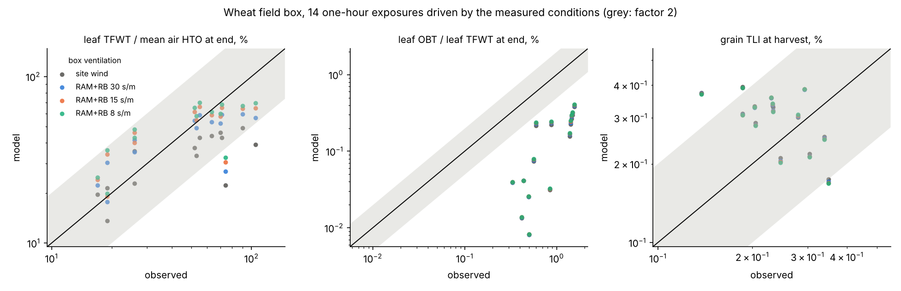

# 模型验证：公开文献数据 × Dmitte HTO 迁移模型

本目录用公开文献中的 HTO 暴露实验结果和公开气象/土壤/作物数据，对 `dmitte` 的空气–土壤–作物
氚迁移模型（`dmitte/transfer_equotions.py` + `dmitte/calc_para.py` + WOFOST）做外部验证。

```
validation/
├── benchmarks/                             # 文献基准 v3：65 条标量基准 + 19 个实验数据集 + 情景卡 + 校准/测试划分（见 benchmarks/README.md）
├── build_inputs.py                         # 从公开数据构建 ./data（气象、土壤、作物参数、农事）
├── run_validation.py                       # 虚拟实验：1 h / 2 h 急性暴露（昼/夜）+ 慢性暴露
├── analyze.py                              # 与文献基准对比，输出表格和图
├── calibrate_night_resistance.py           # 在校准集上标定夜间气孔阻力系数 RC_NIGHT
├── scenario_field_box.py                   # 按情景卡用实测条件驱动小麦田间箱实验（第 4.4 节）
├── calibrate_assimilate_residence.py       # 在田间箱叶片 OBT 时间过程上标定同化物停留时间 TAU_ASSIM（第 4.5 节）
└── results/                                # 运行结果（CSV、图）
```

## 1 结论速览

本节和第 4 节是**基准 v3**（第 2.1 节）在**第三步修正后**的模型上的结果，**只含校准集**。测试集（15 条）已冻结，
至今没有运行、没有查看（第 3 节第 6 条）。第三步共三处修正（植物水平衡、气孔昼夜变化与风速廓线、OBT 按干物质增长生成），
每一处的单独效果见第 4.1 节。之后原来的 default、baomi、Korea、morris 四个迁移率变体合并成一个 `transfer_rates`，
UFOTRI 常数变体删除（第 5.1 节“合并”）；然后在校准集上标定了夜间气孔阻力系数 `RC_NIGHT`（15 → 4，第 4.2 节）。
小麦田间箱的 8 条基准改用逐次实测条件驱动的结果评分（第 4.4 节），`RC_NIGHT` 也在这些结果上重新标定（仍为 4）。
最后加入了叶片新鲜同化物 OBT 库，去掉了茎叶结构 OBT 的周转（第 4.5 节）。下面的结果都是这一版模型。

| 结论 | 依据（校准集） |
|---|---|
| 迁移率全部有限且非负；植物水和果实水的水量平衡闭合 | 负值和非有限值为 0；均匀比活度检验中植物水、果实水的未解释残差为 0（修正前 0.5–160，第 4.3 节） |
| **马铃薯的校准基准没有 ❌** | 慢性块茎 OBT/空气 0.90（0.72–1.14，B18）；块茎 TFWT/空气 1.45（0.57–1.83，B19）；叶片 OBT/TFWT 0.57（0.64–1.3，B20 ⚠️）；根茎代理 TLI 0.13 %（0.11–0.33 %，B13）；白天交换 0.58 h⁻¹（0.5–1.1，B56）；夜间交换 0.23 h⁻¹（0.19–0.42，B57）。修正前块茎 OBT/空气 16、TLI 6.6 %、交换 0.064 h⁻¹ |
| 小麦田间箱的吸收在实测条件下符合 | 实测条件驱动、箱内阻力 15 s/m：白天暴露结束时叶片 TFWT/空气 60 %（54–92 %，B49 ✅），夜间 21 %（17–19 %，B50 ⚠️），夜/昼比 0.35（0.17–0.38，B4 ✅）；14 次中 13 次在 2 倍以内。通用虚拟实验白天只有 25 %，差别来自箱内条件和通风（第 4.4 节） |
| 叶–气交换速率接近文献 | 田间箱暴露后 1 h 内：白天 0.78 h⁻¹（0.85–1.66，B5 ⚠️），夜间 0.19 h⁻¹（0.24–0.38，B29 ⚠️）；小麦温室夜间 0.17 h⁻¹（0.10–0.23，B60 ✅）；昼/夜交换比 2.7–2.8（3–5，B6 ⚠️） |
| 小麦籽粒 TLI 在文献范围内 | 实测条件驱动 0.31 %（0.18–0.32 %，B26 ✅）；修正前 0.025–0.065 % |
| **暴露结束时叶片 OBT 仍偏低** | 加入叶片同化物库后白天 0.66 %（0.91–1.59 %，B22 ⚠️；加库前 0.26 %），夜间 0.13 %（0.33–0.43 %，B23 ❌；加库前 0.04 %）（第 4.5 节） |
| 黎明和黄昏的气孔响应不对 | 实测条件驱动：暴露后 1 h 内叶片 TFWT 损失速率黎明 0.32 h⁻¹（0.69–1.04），黄昏 0.37 h⁻¹（0.06–0.18）；白天 0.78（0.85–1.66）、夜间 0.19（0.24–0.38）接近（第 4.4 节） |
| 叶片 OBT 的时间过程仍不对 | 模型 / 实测：1 h 0.31，2 h 0.74，4 h 1.6，1 d 0.36（加库前 0.11、0.28、0.78、2.7）。模型在暴露后 1–3 h 还在生成 OBT，实测在暴露结束时已基本形成（第 4.5 节） |

判定数从修正前的 马铃薯 1/0/10、小麦 3/2/9（✅/⚠️/❌，原 baomi 变体）变为三步修正后的 马铃薯 6/3/2、小麦 2/6/6，
标定夜间阻力后为 马铃薯 8/3/0、小麦 3/8/3，田间箱基准改用实测条件驱动的结果评分后小麦为 6/6/2。
加入叶片同化物库后为 马铃薯 7/4/0、小麦 6/7/1，剩下的 1 个 ❌ 是夜间暴露结束时的叶片 OBT（B23）。

## 2 数据

### 2.1 文献基准（`benchmarks/`，v3）

详见 [benchmarks/README.md](benchmarks/README.md)。v3 在 v2 的基础上补读了 5 篇原文
（Diabaté & Strack 1997、Strack et al. 2005、Korolevych & Kim 2013、Shen & Guo 2019、Balashov et al. 2011）：

- `literature_benchmarks.csv`：65 条标量基准，每条带实验类型（舱室/田间箱/温室/田间）、示踪剂、暴露时长、C3/C4 和数据性质（实测/拟合/汇编/参数）；
- `datasets/`：19 个逐次实验数据集，新增小麦舱室逐时序列（空气 HTO、温度、湿度、光照和各器官 TFWT/OBT）和玉米 1 h 暴露；
- `scenario_cards.csv`：15 张情景卡，列出每组实验的暴露条件和缺失项，供用实测条件驱动模型；
- `split.csv`：校准集 50 条、测试集 15 条（小麦舱室、马铃薯舱室、Pickering 慢性）。

马铃薯的直接氚数据只有 FZK 舱室实验（TECDOC-1738 表 24，在测试集）和 Balashov 温室拟合速率常数（在校准集）。

### 2.2 模型输入（`build_inputs.py`，全部公开、固定到 commit）

| 输入 | 来源 |
|---|---|
| 气象 | 荷兰 Wageningen Haarweg 站 2004–2008 逐日数据（Wageningen 大学气象组），取自 [ajwdewit/pcse_notebooks](https://github.com/ajwdewit/pcse_notebooks) `data/meteo/nl1.xlsx` |
| 土壤 | `ec2.soil`（EC2-medium，与原研究同名同参数：SMW 0.099、SMFCF 0.272、SM0 0.39），同上仓库 |
| 作物 | WOFOST 7.2 作物参数 [ajwdewit/WOFOST_crop_parameters@wofost72](https://github.com/ajwdewit/WOFOST_crop_parameters/tree/wofost72)：`Potato_701`、`Winter_wheat_102` |
| 农事 | 生成：马铃薯 5 月 1 日出苗，冬小麦前一年 10 月 20 日播种 |
| `meteo_usefor_cttm.xlsx` 中的派生量 | RH = 水汽压 / 日均温饱和水汽压；气压取标准大气（站点海拔 7 m）；5/10/20 cm 土壤含水量 = 同年马铃薯 WOFOST 根区含水量 SM（无作物期取田间持水量 0.272） |

## 3 方法

1. **虚拟实验**，按文献实验流程设计：
   - *急性*：植物在空气水汽 HTO 浓度恒定的箱中暴露 1 h 或 2 h（田间箱实验为 1 h，舱室实验为 2 h），然后回到洁净空气直到收获。
     整个生长季每周做一次，每次分 11:00（白天）和 23:00（夜间）两组。马铃薯 2004–2008 共 5 季、小麦 2005–2008 共 4 季。
     每次暴露记录开花后天数和所处的灌浆阶段（WOFOST 贮藏器官日增量不低于季节最大值一半的时段为线性灌浆期），
     用于对应 Diabaté & Strack (1997) 按灌浆阶段给出的 TLI。
   - *慢性*：整个生长季空气 HTO 恒定（对应 Korolevych & Kim 的连续释放菜园）。
2. **模型原样使用**：迁移率来自 `transfer_rates`（默认选项，仓库中所有算例脚本都调用它）；ODE 右端就是
   `transfer_equotions()` 本身。系统对 y 线性、迁移率逐小时分段常数，所以每小时的传播子 = 生成矩阵的矩阵指数，
   生成矩阵从 `transfer_equotions()` 逐列取出（`solve_con()` 现在也用同样的方法，两者结果一致，见 `diagnostics.csv`）。
   唯一的改动是实验施加的边界条件：空气库室在暴露小时内固定为暴露浓度，其余时间为 0（洁净空气）。
3. **昼夜强迫**：仓库的 `meteodata()` 把日数据线性插值到小时，没有昼夜变化。为检验昼夜基准，`run_validation.py`
   用日数据生成逐时强迫（温度在 TMIN/TMAX 间余弦变化、辐射按太阳高度角分配、RH 由逐时温度计算），通过替换
   `calc_para.meteodata` 注入。同时也用仓库原始的逐日插值强迫跑了一遍（结果见 CSV 中 `forcing=daily`）。
4. **浓度换算**：叶片 TFWT = `A_bh / plant_w`（`plant_w` 为活叶片水，第 5.1 节第三步）；块茎/籽粒 TFWT = `A_fh / friut_w`；
   OBT 以燃烧水计，= OBT 库存 / (干物质 × `COMB_WATER` = 0.556 L/kg)（淀粉/纤维素含氢 6.2 %）；
   叶片 OBT = 叶片同化物 OBT（`ba`）/ 活叶干物质 + 茎叶结构 OBT（`bo`）/ 茎叶干物质（TWLV + TWST）；空气水汽量 = `ML × a_h`。
5. **判定**：取模型中位数（全部年份 × 暴露日期，逐时强迫），落在文献范围内为 ✅ 符合；与范围相差 2 倍以内为 ⚠️ 接近
   （TECDOC-1738 §7.9：模型与实验之间的差异至少为 2 倍，实验误差至少 50 %）；超过 2 倍为 ❌ 偏离；
   ≤0 或发散（|log₁₀| > 30）为 ⛔ 非物理。只给中心值的基准按 ×/÷1.5 作为容差。
   每项比较按同作物、同暴露时长对应；没有本作物数据时用代理作物，并在结果中标明。
6. **校准集与测试集**：`benchmarks/split.csv` 把 15 条基准和 4 个数据集划为测试集，按实验活动整体划分：
   FZK 小麦舱室实验（Diabaté & Strack 1997）、FZK 马铃薯舱室实验（TECDOC-1738 表 24）、Pickering 慢性释放。
   除 B12 外它们此前都没有参与过模型对比（B12 在 v1–v2 报告中出现过，属于已知泄漏）。
   `analyze.py` 默认只比较和绘制校准集；测试集的指纹（sha256）记录在 `analyze.py` 中，`tests/test_smoke.py` 检查它没有被改动。
   模型修改全部完成后，用 `python validation/analyze.py --include-test` 运行一次测试集。
7. **田间箱基准用实测条件驱动的结果评分**：小麦田间箱的 B4、B5、B22、B23、B26、B29、B49、B50 来自同一组 14 次暴露，
   由 `scenario_field_box.py` 逐次复现（第 4.4 节），`analyze.py` 从 `results/scenario_field_box.csv` 取模型值。
   箱内空气动力学阻力没有报告，评分取 15 s/m，同时列出 8 和 30 s/m 的结果。白天、夜间分别取 09–15 时和 23 时的暴露。
   第三步的修正只看了校准集；其中 `OBT_DARK` 取自校准基准 B15 的中值，所以 B15 不再是独立检验。

## 4 结果

完整表见 `results/benchmark_comparison.csv`（含 5–95 % 分位）。下表为校准集各项的模型中位数与判定（当前模型：含叶片同化物库，`RC_NIGHT = 4`；田间箱基准用实测条件驱动的结果）。
“匹配”列：本作物 = 同一作物的实验；代理 = 其他作物（马铃薯用萝卜、小麦用水稻）；通用 = 多作物汇总值。

| 基准 | 作物 | 文献指标 | 实验作物与类型 | 匹配 | 模型 | 文献 |
|---|---|---|---|---|---|---|
| B1 | 马铃薯 | leaf TFWT at end of 1 h exposure / mean air-moisture HTO | radish；field box | 代理 | 25 ✅ | 22–46 % |
| B10 | 马铃薯 | TFWT decrease factor from end of exposure to harvest | radish root；field box | 代理 | 14 ✅ | 0–1.3×10⁴ - |
| B13 | 马铃薯 | TLI = OBT in root at harvest / leaf TFWT at end of exposure | radish；field box | 代理 | 0.13 ✅ | 0.11–0.33 % |
| B56 | 马铃薯 | leaf TFWT fast loss rate constant k1 after daytime exposure | potato；greenhouse | 本作物 | 0.58 ✅ | 0.5–1.1 h-1 |
| B57 | 马铃薯 | leaf TFWT fast loss rate constant k1 after night exposure | potato；greenhouse | 本作物 | 0.23 ✅ | 0.19–0.42 h-1 |
| B58 | 马铃薯 | leaf HTO uptake rate constant (day) | potato；greenhouse | 本作物 | 0.58 ⚠️ | 0.93–2.1 h-1 |
| B6 | 马铃薯 | day/night ratio of leaf HTO uptake rate | most crops (not young lettuce)；review | 通用 | 2.7 ⚠️ | 3–5 - |
| B15 | 马铃薯 | night/day ratio of OBT formation at equal leaf HTO | wheat, rice, potato, bean, Chlorella；review | 通用 | 0.61 ⚠️ | 0.1–0.5 - |
| B18 | 马铃薯 | fruit/tuber OBT (Bq/L comb. water) / air HTO (Bq/L) averaged at pod filling | tomato, pepper, potato (pooled)；field | 本作物 | 0.91 ✅ | 0.72–1.1 - |
| B19 | 马铃薯 | fruit/tuber HTO / air HTO averaged 3 d before harvest | tomato, pepper, potato (pooled)；field | 本作物 | 1.5 ✅ | 0.57–1.8 - |
| B20 | 马铃薯 | plant OBT / plant TFWT at equilibrium (isotopic discrimination factor) | various；review | 通用 | 0.57 ⚠️ | 0.64–1.3 - |
| B4 | 小麦 | night/day ratio of leaf HTO uptake | wheat；field box | 本作物（实测条件驱动） | 0.35 ✅（0.34–0.36） | 0.17–0.38 - |
| B49 | 小麦 | leaf TFWT / air-moisture HTO at end of 1 h exposure (day) | wheat；field box | 本作物（实测条件驱动） | 60 ✅（55–64） | 54–92 % |
| B50 | 小麦 | leaf TFWT / air-moisture HTO at end of 1 h exposure (night) | wheat；field box | 本作物（实测条件驱动） | 21 ⚠️（19–21） | 17–19 % |
| B5 | 小麦 | leaf TFWT loss rate constant within 1 h after daytime exposure | wheat；field box | 本作物（实测条件驱动） | 0.78 ⚠️（0.78–0.78） | 0.85–1.7 h-1 |
| B29 | 小麦 | leaf TFWT loss rate constant within 1 h after night exposure | wheat；field box | 本作物（实测条件驱动） | 0.19 ⚠️（0.19–0.19） | 0.24–0.38 h-1 |
| B59 | 小麦 | leaf TFWT fast loss rate constant k1 after daytime exposure | wheat；greenhouse | 本作物 | 0.5 ⚠️ | 0.55–1.2 h-1 |
| B60 | 小麦 | leaf TFWT fast loss rate constant k1 after night exposure | wheat；greenhouse | 本作物 | 0.17 ✅ | 0.1–0.22 h-1 |
| B6 | 小麦 | day/night ratio of leaf HTO uptake rate | most crops (not young lettuce)；review | 通用 | 2.8 ⚠️ | 3–5 - |
| B22 | 小麦 | leaf OBT (comb. water) / leaf TFWT at end of 1 h exposure (day) | wheat；field box | 本作物（实测条件驱动） | 0.66 ⚠️（0.64–0.67） | 0.91–1.6 % |
| B23 | 小麦 | leaf OBT (comb. water) / leaf TFWT at end of 1 h exposure (night) | wheat；field box | 本作物（实测条件驱动） | 0.13 ❌（0.13–0.13） | 0.33–0.43 % |
| B15 | 小麦 | night/day ratio of OBT formation at equal leaf HTO | wheat, rice, potato, bean, Chlorella；review | 通用 | 0.76 ⚠️ | 0.1–0.5 - |
| B26 | 小麦 | TLI grain (OBT at harvest / leaf TFWT at end of 1 h exposure) | wheat；field box | 本作物（实测条件驱动） | 0.3 ✅（0.3–0.3） | 0.18–0.32 % |
| B9 | 小麦 | TFWT decrease factor from end of exposure to harvest | rice；field box | 代理 | 1×10⁴ ✅ | 600–9.5×10⁴ - |
| B20 | 小麦 | plant OBT / plant TFWT at equilibrium (isotopic discrimination factor) | various；review | 通用 | 0.68 ✅ | 0.64–1.3 - |

判定数（校准集，✅ 符合 / ⚠️ 接近 / ❌ 偏离）：马铃薯 7 / 4 / 0，小麦 6 / 7 / 1。“实测条件驱动”各行括号内为箱内阻力取 8–30 s/m 时的模型中位数。

读表时注意：
- 温室（B56–B60）和舱室实验强制通风，叶–气速率比田间偏高；田间箱实验箱内温度在暴露期间升高约 10 °C（TECDOC-1738 §7.9）。
- B15 的模型指标是暴露后 24 h 内生成的 OBT（夜间暴露 / 白天暴露，按暴露结束时叶片 HTO 归一化），会把夜间叶片
  HTO 保留到天亮后的光合生成也算进去；夜间交换偏慢时它偏高（第 5.2 节 1）。
- 玉米（B7、B8、B64）是 C4 作物，不用于判定马铃薯和小麦，只作 C4 参照保留在基准表中。

### 4.1 三处修正的逐步效果

每一步都在前一步基础上累加，校准集判定数（✅ / ⚠️ / ❌）。当时代码中还有 baomi 和 default 两个变体；
合并后的模型取 baomi 的两个选项（第 5.1 节“合并”），结果与第 ③ 行的 baomi 列逐项相同：

| 步骤 | 马铃薯 baomi | 马铃薯 default | 小麦 baomi | 小麦 default |
|---|---|---|---|---|
| 修正前（`bad8dc1`） | 1 / 0 / 10 | 1 / 0 / 10 | 3 / 2 / 9 | 3 / 2 / 9 |
| ① 植物水平衡 | 2 / 2 / 7 | 2 / 2 / 7 | 2 / 4 / 8 | 2 / 5 / 7 |
| ② + 风速廓线、气孔昼夜变化 | 3 / 2 / 6 | 3 / 2 / 6 | 2 / 5 / 7 | 2 / 6 / 6 |
| ③ + OBT 按干物质增长生成 | 6 / 3 / 2 | 6 / 2 / 3 | 2 / 6 / 6 | 3 / 5 / 6 |

主要变化（baomi）：
- ① 修正后块茎 TFWT/空气 12.3 → 1.5（B19 ✅）。叶片水改为活叶片水后，小麦叶片水从 0.3 kg/m² 增加到约 1.2 kg/m²，
  白天交换从 1.34 降到 0.21 h⁻¹：修正前小麦交换速率“符合”，是因为叶片水被籽粒干物质比例 0.86 低估了约 4 倍，正好抵消了过大的空气动力学阻力。
- ② 风速廓线修正把 RAM + RB 从约 240 s/m 降到 50–70 s/m；气孔白天按 `RCMIN·RPHO`、夜间按 `15·RCMIN` 取值后，
  马铃薯白天交换 0.58 h⁻¹（B56 ✅），小麦夜/昼吸收比 1.04 → 0.20（B4 ✅），夜间交换降到 0.05–0.08 h⁻¹（偏慢）。
- ③ 慢性块茎 OBT/空气 7.5 → 0.92（B18 ✅），叶片 OBT/TFWT 3.6 → 0.75（B20 ✅），根茎 TLI 1.1 → 0.19 %（B13 ✅），
  小麦籽粒 TLI 0.087 → 0.37 %（B26 ⚠️）；暴露结束时叶片 OBT 从 1.7 % 降到 0.29 %（B22 ❌），夜间降到 0.05 %（B23 ❌）。

各步的完整对比表没有入库；在对应的模型代码上重跑 `run_validation.py` 和 `analyze.py` 即可得到。

### 4.2 夜间气孔阻力系数的标定

夜间（以及 RH > 98 %）的气孔阻力为 `RC_NIGHT × RCMIN`（`para_constant.RC_NIGHT`），原值 15 没有出处。
`calibrate_night_resistance.py` 在网格 1–15 上逐个重跑通用虚拟实验和实测条件驱动的田间箱实验（第 4.4 节），
只用校准集中的夜间基准作目标：小麦 B29（田间箱夜间损失速率）、B60（温室夜间速率）、B50（田间箱夜间 1 h 吸收）、
B4（田间箱夜/昼吸收比）、B6（昼/夜交换比，综述），马铃薯 B57、B6。B4、B29、B50 用实测条件驱动的结果。
目标函数是各目标“模型中位数偏出文献范围的倍数”取 log₁₀ 后的平方和（落在范围内为 0）。结果见 `results/calibration_rc_night.csv`。

| RC_NIGHT | 1 | 2 | 3 | **4** | 5 | 6 | 8 | 10 | 15 |
|---|---|---|---|---|---|---|---|---|---|
| 两种作物 | 0.73 | 0.23 | 0.051 | **0.015** | 0.032 | 0.063 | 0.16 | 0.31 | 0.83 |
| 只用小麦 | 0.57 | 0.17 | 0.035 | **0.013** | 0.032 | 0.062 | 0.14 | 0.26 | 0.66 |
| 只用马铃薯 | 0.16 | 0.056 | 0.015 | 0.003 | **0.000** | 0.001 | 0.018 | 0.049 | 0.17 |

| 目标（RC_NIGHT = 3 / 4 / 5） | 文献 | 模型 |
|---|---|---|
| B29 小麦田间箱夜间损失速率，h⁻¹ | 0.24–0.38 | 0.23 / 0.19 / 0.16 |
| B60 小麦温室夜间速率，h⁻¹ | 0.10–0.23 | 0.22 / 0.17 / 0.14 |
| B50 小麦田间箱夜间 1 h 吸收，% | 17–19 | 26 / 21 / 17 |
| B4 小麦田间箱夜/昼吸收比 | 0.17–0.38 | 0.44 / 0.35 / 0.29 |
| B6 昼/夜交换比（小麦 / 马铃薯） | 3–5 | 2.3 / 2.8 / 3.4；2.3 / 2.7 / 3.1 |
| B57 马铃薯夜间速率，h⁻¹ | 0.19–0.42 | 0.28 / 0.23 / 0.20 |

- 两种作物一起标定仍得 4；只用小麦得 4、只用马铃薯得 5。用小麦标定的 4 在马铃薯上的目标值为 0.003（马铃薯自身最优为 0），
  两种作物一致，取 `RC_NIGHT = 4`。目标函数在 3–5 之间都很小，敏感性分析中可取 3–6。
- 夜间叶片阻力因此为 4 × RCMIN = 800 s/m（小麦）和 600 s/m（马铃薯），冠层阻力（÷ LAI 4–6）约 100–200 s/m，
  与夜间速率基准对应的 100–150 s/m 相符；原值 15 对应约 500 s/m。
- 上一版只用通用虚拟实验标定，最优值也是 4，但目标函数为 0.066：夜间绝对速率要求 2–3，昼夜比要求 5–8，看起来像白天交换偏低。
  田间箱改用实测条件驱动后，白天吸收进入范围，这个矛盾基本消失（目标函数 0.015）；B4 从 ⚠️（0.58）变为 ✅（0.35）。
- 与原值 15 相比，校准集中目标以外的基准也随之变化：萝卜代理的 1 h 吸收 11 → 25 %（B1 变为 ✅），B15 0.97–1.18 → 0.56–0.75（小麦从 ❌ 变为 ⚠️），
  根茎 TLI 0.19 → 0.13 %，小麦 B20 0.58 → 0.68（变为 ✅）；目标以外没有判定变差，白天指标不变。

### 4.3 均匀比活度检验

`water_balance_residual()`：所有水库室取同一比活度、不计衰变和 OBT、去掉叶片释放中的分馏，计算 dA/dt ÷ A。
水量闭合时它等于水量的相对变化 dlnW/dt；下表为两者之差相对该库室流出速率 k_out 的逐时中位数
（`diagnostics.csv` 中的 `wbabs_*`，越接近 0 越好）：

| 作物 | 土壤 1 | 土壤 2 | 土壤 3 | 植物水 | 果实水 |
|---|---|---|---|---|---|
| 马铃薯 | 0.66（修正前 0.50） | 0.71（0.47） | 0.82（0.55） | **0**（0.47） | **0**（21） |
| 小麦 | 0.62（0.55） | 0.55（0.31） | 0.53（0.47） | **0**（0.90） | **0**（160） |

括号内为第三步修正前 baomi 变体的值。土壤下渗改用达西式（`percolation='darcy'`）时，土壤第 3 层为 5.6（马铃薯）和 46（小麦）。

植物水和果实水现在按构造闭合（`plant_water_routes()`，测试 `test_plant_and_fruit_water_balance_closes`）。
土壤三层仍不闭合（第 5.2 节 4）。


### 4.4 按情景卡驱动小麦田间箱实验

第 4 节的判定来自通用虚拟实验（Wageningen 天气、11:00/23:00、恒定浓度方波）。田间箱基准（B5、B22、B23、B26、B29、B49、B50）
来自同一组 14 次 1 h 暴露（TECDOC-1738 表 22，情景卡 `WHEAT_FB`），每次都有箱内温度、RH、PPFD 和开花后天数，
所以可以逐次复现。`scenario_field_box.py` 对每次暴露、每个 WOFOST 小麦季（2005–2008）：

- 暴露放在开花后相同天数（WOFOST DVS = 1 为开花）的同一时刻；
- 暴露小时用实测箱内温度、RH、PPFD（全辐射 = PPFD / 2.2），无降雨；暴露后 1 h 沿用这些值（室外条件没有报告），风速用站点值；
- 空气 HTO 按箱内实测时间过程（图 26，每 5 min 读一点，新增数据集 `wheat_DE_field_box_air_HTO.csv`）以 5 min 步长积分，
  并以 1 h 均值归一；没有曲线的实验用 5 条曲线的平均形状；
- 箱内风速没有报告，所以暴露小时的空气动力学阻力 RAM + RB 取四种：站点风速（中位数 76 s/m）、30、15、8 s/m。
  风扇通风的小箱内，叶片边界层阻力量级为 10–20 s/m（叶宽约 1 cm、风速 0.5–1 m/s），冠层尺度更小，所以后三种更接近实际。

实测对照（全部在校准集）：每次暴露结束时的叶片 TFWT / 箱内平均空气 HTO（图 25，从柱状图读取，加入 `wheat_DE_field_box_1h.csv`）、
叶片 OBT 在 1 h、2 h、4 h、1 d 时相对暴露结束时 TFWT 的比值（图 27）、收获期籽粒 TLI，以及按时段的暴露后 1 h 内 TFWT 半衰期（表 23）。
结果见 `results/scenario_field_box.csv` 和下图（4 季中位数）。

| 指标（14 次暴露） | 模型 / 实测几何均值 | 2 倍以内 | 秩相关 |
|---|---|---|---|
| 叶片 TFWT/空气，站点风速 | 0.70 | 12 / 14 | 0.71 |
| 叶片 TFWT/空气，RAM + RB 30 / 15 / 8 s/m | 0.92 / 1.02 / 1.07 | 13 / 14 | 0.65–0.69 |
| 叶片 OBT/TFWT，1 h / 2 h / 4 h / 1 d | 0.11 / 0.28 / 0.78 / 2.7 | 0 / 5 / 10 / 3–4（共 14 / 14 / 12 / 12） | 0.85 / 0.67 / 0.62–0.66 / 0 |
| 籽粒 TLI | 1.24 | 11 / 14 | −0.6 |

| 暴露后 1 h 内叶片 TFWT 损失速率，h⁻¹ | 黎明（07–08 时） | 白天（09–15 时） | 黄昏（20 时） | 夜间（23 时） |
|---|---|---|---|---|
| 模型 | 0.32 | 0.78 | 0.37 | 0.19 |
| 表 23（ln2 / 半衰期） | 0.69–1.04 | 0.85–1.66 | 0.06–0.18 | 0.24–0.38 |

白天暴露（09–15 时，B49 54–92 %）的叶片 TFWT/空气平均为：站点风速 43 %，30 s/m 56 %，15 s/m 62 %，8 s/m 65 %；
夜间暴露（23 时，B50 17–19 %）为 17–22 %。

1. **白天吸收的差距主要来自虚拟实验的条件**：通用实验 25 % → 实测箱内条件 43 % → 箱内通风 56–65 %。只要箱内 RAM + RB ≤ 30 s/m，
   B49 就在文献范围内，14 次暴露中 13 次在 2 倍以内，模型还复现了不同暴露之间的差异（秩相关约 0.7）。第 4 节中 B49 的 ❌
   和“白天交换偏低约 2 倍”的判断，大部分是通用虚拟实验造成的；暴露后的白天交换速率为 0.78 h⁻¹，只略低于 0.85–1.66。
2. **气孔在黎明和黄昏的响应不对**：模型的气孔只随当时的光照变化，黎明弱光下开得太小（0.32 vs 0.69–1.04 h⁻¹，f14 的吸收低 3 倍），
   黄昏还有光时又开得太大（0.37 vs 0.06–0.18 h⁻¹）。实测的气孔清晨开得早、傍晚关得早，有昼夜节律或滞后，现有公式表达不了。
3. **叶片 OBT 生成太慢、留存太久**：暴露结束时只有实测的 0.11 倍，4 h 时接近（0.78），1 d 时变成 2.7 倍。实测的叶片 OBT 在 1–2 h
   达到峰值后一天内运出大半，模型的茎叶 OBT 只按 10 d 半衰期周转。这正是第 5.2 节 2 的新鲜同化物库问题，时间过程给出了它的速率：
   一天内运出。（本节为加入同化物库之前的结果；加入之后见第 4.5 节。）
4. **籽粒 TLI 的量级对，日内变化不对**：几何均值 1.24，但秩相关为 −0.6。实测 TLI 没有明显的日内变化（Strack et al. 2005：中位数 0.23 %），
   模型的 TLI 随暴露时刻变化：OBT 生成按辐射分配，夜间暴露后的叶片 HTO 又留到天亮。

之后的处理：田间箱的 8 条基准改用这里的结果评分（箱内阻力取 15 s/m，8–30 s/m 作为范围，第 3 节第 7 条），
`RC_NIGHT` 也在这些结果上重新标定（第 4.2 节）。



### 4.5 叶片新鲜同化物库

第 4.4 节的叶片 OBT 时间过程说明，模型缺少“刚合成、随后运出或被呼吸掉”的同化物。第三步的 OBT 生成按净干物质增长，
所以暴露结束时叶片 OBT 只有实测的 0.11 倍；茎叶 OBT 只按 10 d 半衰期周转，所以 1 d 后又是实测的 2.7 倍。现在叶片里加了第 11 个库室
`ba`（叶片新鲜同化物 OBT，放在 `A_NAMES` 最后，前 10 个库室的编号不变）：

- 叶片水 → `ba`：`ID_OBT × COMB_CH2O × 总光合 × C_leaf`，总光合取 WOFOST 的 `PGASS`（kg CH₂O，`COMB_CH2O = 0.6` 为 CH₂O 的燃烧水当量），
  日内分配与第三步相同（白天按辐射，夜间为白天平均的 `OBT_DARK` 倍）；
- `ba` 以停留时间 `TAU_ASSIM` 一阶流出，按当天的干物质分配去向：茎叶增长 → `bo`，籽粒/块茎增长 → `fo`，其余（呼吸、根）的氢回到叶片水。
  所以 `bo`、`fo` 得到的 OBT 通量与第三步相同（ID × 燃烧水 × 干物质增长 × C_leaf），只是推迟约 `TAU_ASSIM`；果实 OBT 不再从叶片水直接生成；
- 茎叶结构 OBT 的周转 `KBO_BH` 改为 0。原值 10 d 半衰期来自 UFOTRI；第三步为了保持长期平衡给它配了等量的补充生成，
  但诊断显示这一项在正午与总光合生成一样大（f4 暴露：0.0021 对 0.0022 h⁻¹），相当于每天重新合成约 7 % 的茎叶干物质，
  且不经同化物库直接留在茎叶里，正是 1 d 后叶片 OBT 偏高的来源。TECDOC-1991 式 43 只有生长稀释，没有周转项；
  去掉后，生长期间形成的结构 OBT 不再回到 HTO。

`TAU_ASSIM` 只影响暴露后叶片 OBT 的时间过程，所以 `calibrate_assimilate_residence.py` 只用其形状标定：田间箱 14 次暴露在 2 h、4 h、1 d 时的
叶片 OBT 相对 1 h（暴露结束）的比值（图 27，校准集）。暴露结束时的绝对水平（B22、B23）不参与拟合，留作对生成速率的检验。
目标函数为各暴露、各时刻模型与实测比值的 log₁₀ 差的平方和（`results/calibration_tau_assim.csv`）：

| TAU_ASSIM，h | 2 | 4 | **6** | 9 | 12 | 18 | 24 | 48 |
|---|---|---|---|---|---|---|---|---|
| 目标函数 | 21.0 | 12.6 | **11.3** | 14.3 | 17.5 | 22.1 | 24.9 | 29.8 |

保留 10 d 周转时，目标函数随 τ 减小单调下降，最优值落在网格边界（1 h），1 d 的值不随 τ 变化（2.7 倍），说明问题不在 τ。
去掉周转后最优值落在网格内部，取 `TAU_ASSIM = 6 h`。

| 叶片 OBT / 暴露结束时叶片 TFWT，% | 1 h | 2 h | 4 h | 1 d |
|---|---|---|---|---|
| 实测（14 次中位数） | 0.72 | 0.74 | 0.70 | 0.31 |
| 模型，加库前（模型/实测几何均值） | 0.11 | 0.28 | 0.78 | 2.7 |
| 模型，加库后（中位数 %；模型/实测几何均值） | 0.36；0.31 | 0.80；0.74 | 1.27；1.62 | 0.09；0.36 |

对校准集的影响：白天暴露结束时的叶片 OBT（B22）0.26 % ❌ → 0.66 % ⚠️，夜间（B23）0.04 % → 0.13 %（仍 ❌）；
马铃薯长期叶片 OBT/TFWT（B20）0.80 ✅ → 0.57 ⚠️：没有周转补充后，叶片 OBT 记录的是生长期间的叶片 HTO，而不是收获时的；
B9（叶片 TFWT 从暴露结束到收获的降幅）3 800 → 10 000（仍 ✅），因为结构 OBT 不再分解回叶片水。
判定数 马铃薯 8/3/0 → 7/4/0，小麦 6/6/2 → 6/7/1。

仍然不对的是形状：模型在暴露后 1–3 h 叶片 HTO 还没降下去时继续生成 OBT，所以从 1 h 到 4 h 一直上升；实测在暴露结束时已经基本形成，
之后持平，1 d 时降到约 0.3 %。一阶的单一同化物库做不到两者兼顾（τ 短则 1 d 太低，τ 长则 4 h 太高）。实测曲线提示暴露期间的标记
比按总光合计算的快得多（例如糖类中可快速交换的氢位），这需要另一种机制，没有在这一版中加入。

## 5 发现的问题

### 5.1 已修正

第一至第三步修正时代码中还有多个迁移率变体（default、baomi、Korea、morris、UFOTRI），下面各表的“影响的函数”指当时的变体；
它们现在已合并（本节最后）。

**第一步**（单位与索引；回归测试 `tests/test_rate_fixes.py`）：

| 问题 | 修正 | 影响的函数 |
|---|---|---|
| OBT 食入剂量系数写成 4.2e-7 mSv/Bq | ICRP-72 成人值 4.2e-8（HTO 1.8e-8 不变），集中到 `para_constant.DOSE_COEF_OBT/HTO` | 所有剂量脚本，OBT 剂量降为原来的 1/10 |
| Penman–Monteith：`CP = 1.013`、`GAM = 0.67` | `CP = 1013` J/(kg·K)、`GAM = 0.067` kPa/K | `calc_ESOIL`、`calc_ETRM` |
| `ks1_a2 = ESOIL / BODW1`（分母是体积含水率） | 改为第 1 层水量 `soil1w` | default、Korea、baomi、morris |
| `ks3_bh`、`ks3_fh` 分母用了 `soil1w` | 改为 `soil3w` | CEREAL/ROOT_VEG 的全部变体 |
| `kbh_fo = np.log(2/(HWZ/2))`（恒为负、缺 `/24`） | `np.log(2)/(HWZ/2)/24` | default、UFOTRI、Korea 的 CEREAL；TUBER_VEG |
| `HWZ[airfx.sta-1]`（用稳定度索引作物参数，`sta=6` 时 IndexError） | `HWZ[airfx.ICOMP-1]` | 同上 |
| `np.log2(10)` | `np.log(2)` | default、UFOTRI、Korea 的 CEREAL `kbh_fh`；Korea `kbo_bh` |

**第二步**（守恒与非负；测试 `tests/test_conservation.py`）：

| 问题 | 修正 |
|---|---|
| `kbh_so` 从植物库室流出后没有去向（质量泄漏） | 流入土壤第 1 层（`dA_s1_dt` 加 `+ kbh_so·A_bh`）。现在 ODE 只通过三个外部汇损失活度：`ka1_a1`、`ka2_a2`（扩散出混合层）和 `ks3_s3`（深层渗漏） |
| `kbh_bo = TROBT` 在衰老期为负 | 第三步中 `TROBT` 已按干物质增长重写，按构造非负 |
| 达西式 `ks1_s2 = Va_b1/100`、`ks2_s3 = Va_b2/150` 在向上水流时为负 | `_split_darcy()` 拆成两个非负速率：负值部分按相同水通量改为下层 → 上层（加到 `ks2_s1`、`ks3_s2`） |
| 果实/块茎形成前 `friut_w = 0`，`kfh_bh = kbh_fh·plant_w/friut_w` 为 inf | `_assemble()`：果实水为 0 的时刻不向果实迁移，根系吸水全部进入植物水；植物水为 0（出苗前）的时刻进出植物的迁移率都为 0 |
| `iaea-case1-HTO.py` 用 `np.abs(k_array)` 掩盖负值 | 去掉 `abs()`；`solve_con()` 调用 `check_rates()`，遇到负值或非有限值直接报错并列出迁移率名 |
| 没有水量闭合检验 | `water_balance_residual()`：均匀比活度检验，结果写入 `diagnostics.csv`（`wb_*`、`wbabs_*`），见第 4.3 节 |

**review #8：叶–气 HTO 对称交换**：`kbh_a2 = VDPF · ρ_sat / (ALF_HTO · plant_w)`，与吸收项 `ka2_bh = VDPF / ML` 共用总导度
`VDPF = 1/RGES`。吸收通量 g·ρ_v·C_air，释放通量 g·ρ_sat·C_leaf/α，稳态 C_leaf = α·RH·C_air，夜间照常交换。
用于 default、Korea、baomi、morris；UFOTRI 是文献常数，不变。

**第三步**（本次提交；测试 `tests/test_conservation.py`、`tests/test_rate_fixes.py`、`tests/test_smoke.py`）。
default、Korea、baomi、morris 四个变体都改；UFOTRI 的常数不变。

| # | 问题 | 修正 |
|---|---|---|
| ① | 植物水 `plant_w` 用 TAGP 计算，TAGP 含籽粒/块茎，而果实水已单独计入 `friut_w`；含水量用的是贮藏器官的干物质比例（小麦 0.86），叶片水被低估约 4 倍 | `plant_w` = 活叶片水 = TWLV × (LAI / 至今最大 LAI) × 0.8/0.2；叶片含水 80 %（`DMF_LEAF = 0.2`，TECDOC-1991 式 43；Diabaté & Strack 1997）。TWLV 含枯叶，按 LAI 折算 |
| ① | 根系吸水按“大气向植物的沉积通量”计算（`ka2_bh·atm_h·9`），是蒸腾的 2.5–5 倍，多出的水没有出口 | `plant_water_routes()`：根系总吸水 = 净蒸腾 + `kbh_so`·W_bh + d(W_bh + W_fh)/dt。净蒸腾 = g(ρ_sat − ρ_v)，与叶–气交换共用导度，所以植物水按构造闭合（未用 ETRM 或 WOFOST TRA，因为它们和 g 不一致，闭合不了） |
| ① | 果实水：baomi/morris `kfh_bh` 用 `np.maximum(friut_w, 20)` 作下限；default 马铃薯根系向块茎的吸水没有对应流出 | 植物 → 果实液流取各变体原来的 `kbh_fh`·W_bh，果实 → 植物回流取余量，使果实水的净流入等于 dW_fh/dt；下限去掉 |
| ① | `ka2_bh` 的降雨项把雨水整体放进植物水，没有出口，同一份雨水在 `ka2_s1` 中又进入土壤一次 | 降雨不截留在植物上，只进入土壤 |
| ② | **风速廓线**（新发现）：输入是 10 m 风速，`calc_USTERN` 却按 100 m 测量高度外推（`U10·(10/100)^p`），100 m 风速反而小于 10 m；摩擦速度低约 5 倍，RAM + RB ≈ 240 s/m | 测量高度 `ZREF = 10`：`U100 = U10·(100/10)^p`，稳定条件 `U10·(URN/10)^p`；RAM + RB 降到 50–70 s/m。影响土壤沉积 `VDSO`、`ESOIL`、`ETRM` 和叶–气交换 |
| ② | 气孔阻力：`... \| (ISTRE == 1)` 恒为真，RC1 = 15·RCMIN/LAI 昼夜不变；`RGES = RAM + RB + RC1` 把 s/cm 的 RC1 当 s/m 用 | 白天 `RCMIN·RPHO`（`RPHO` 原来已算出但没有用），夜间（PAR < 2 W/m²）和 RH > 98 % 时 `15·RCMIN`；`RGES = RAM + RB + 100·RC1`。原条件中的“有降雨”去掉：逐时降雨是日雨量均分到 24 h，保留它会让每个雨天整天关闭气孔 |
| ③ | `TROBT` 由潜在总同化 − 维持呼吸乘经验系数得到，与植物 HTO 库存的大小无关，昼夜不变；`kbh_fo` 是 ln2/HWZ 的一阶速率，与籽粒/块茎增长无关 | `calc_transOBT()`，TECDOC-1991 式 43：OBT 生成通量 = `ID_OBT`（0.8）× `COMB_WATER` × 干物质增长 × 叶片水比活度。茎叶（`kbh_bo`）按 TWLV + TWST 的增长再加上 `kbo_bh` 周转的补充，使长期暴露下茎叶 OBT/TFWT → 0.8；果实（`kbh_fo`）按 TWSO 的增长。日生成量按逐时辐射分配到白天，夜间为白天平均速率的 `OBT_DARK` = 0.3 倍 |
| — | `solve_con()` 用显式 RK45，籽粒形成初期迁移率可达 10³–10⁴ h⁻¹，与矩阵指数解相差 6–100 %（review #19）；去掉果实水下限后 baomi 也受影响 | 每小时用生成矩阵的矩阵指数（迁移率在一小时内不变时是精确解）；与验证程序的结果一致到机器精度 |

新增参数（`para_constant.py`）：`DMF_LEAF = 0.2`、`ID_OBT = 0.8`、`COMB_WATER = 0.556`、`KBO_BH`（原各变体中的 10 d 半衰期，后改为 0，见下）、
`OBT_DARK = 0.3`。前四个来自文献，没有用基准调过。`OBT_DARK` 的文献范围是 0.1–0.5
（Moses & Calvin：1/3；Thompson & Nelson：0.1；小麦叶片约 0.5，TECDOC-1738 §7.1–7.2），取的是校准基准 B15 的中值。
`ETRM` 不再进入任何迁移率，`dmitte_morris.py` 对它的扰动不影响结果。

**合并迁移率变体**。第三步之后，default 和 baomi 只剩两处不同，原来 baomi 特有的 `kbh_a2 × 100`
和果实水下限都已作为错误去掉。四个变体合并成一个 `transfer_rates`，两处不同改为参数：

| 参数 | 选项 | 默认值与依据 |
|---|---|---|
| `percolation` | `'constant'`：第 1→2 层 0.181×9/24、第 2→3 层 0.072×9/24 kg m⁻² h⁻¹（原 baomi）；`'darcy'`：`calc_soil_ab` 的达西通量（原 default） | `'constant'`（`para_constant.PERCOLATION`）。两种选项的校准判定完全相同，但达西式量纲不自洽（review #7），使土壤第 3 层的水量检验残差达 5.6–46（常数下渗为 0.57–0.94） |
| `kbh_fh` | 植物水 → 果实水的交换速率（不含生长所需的净液流） | ln2/80 ≈ 0.0087 h⁻¹（`para_constant.KBH_FH`，原 baomi）。与原 default 小麦的 ln2/2 相比，校准判定只有小麦 B20 不同（0.58 ⚠️ 对 0.65 ✅），基准不足以区分，留给敏感性分析 |

其他改动：
- 删除 `transfer_rates_UFORTI`。有了文献基准，模型对错由数据判断；这个函数也不是完整的 UFOTRI（小麦的 OBT 生成、叶菜和小麦的根系吸水
  用的是本模型的公式）。“动态 vs 常数迁移率”的对比应该用本模型冻结时间变化后的版本，在做那组实验时再设计；
  EMRAS 多模型比较用文献发表的 UFOTRI 结果，不需要这个函数。
- 删除没有调用者的 Korea、morris 变体和不在 `Plant_dict` 中的 TUBER_VEG 分支（`Calc_air` 无法构建这种作物，是死代码）。
- 叶菜（LEAFY_PLANT）的叶片 OBT 生成原来为 0，现在与其他作物一样用 `TROBT`。
- `potato_HTO.py`、`cereals_HTO.py`、`tomatoes_HTO.py`、`dmitte_morris.py`、`pcse_morris.py` 改调 `transfer_rates`；
  前三个脚本中与 UFOTRI 逐项对比迁移率的作图删除。`tomatoes_HTO.py`、`iaea-case1-HTO.py` 原来用 default，结果会随默认选项变化。
- `pcse_morris.py` 原来复制了一份约 540 行的旧 `calc_para.py`（含第一至三步修正前的全部问题），只为把气象换成 Morris 样本值；
  现在直接用 `dmitte.calc_para` 的类，只替换 `meteodata`。它以前的 Morris 结果来自修正前的模型。
- 合并后的模型在校准集上与第三步后的 baomi 结果逐项相同（25 项比较，最大相对差 0）。

**标定夜间气孔阻力系数**（本次提交）：`calc_st_res` 中写死的 15 改为 `para_constant.RC_NIGHT`，在校准集上标定为 4（第 4.2 节）。

**叶片新鲜同化物库**（本次提交，第 4.5 节）：新增库室 `ba`（`A_NAMES` 第 11 个）和迁移率 `kbh_ba`、`kba_bh`、`kba_bo`、`kba_fo`
（`K_NAMES` 末尾）；果实 OBT 改为经同化物库生成（`kbh_fo = 0`）；`KBO_BH` 10 d 半衰期 → 0；新增参数 `COMB_CH2O = 0.6`、
`TAU_ASSIM = 6 h`（在校准集上标定）。`solve_con()` 返回 11 列；`potato_HTO.py`、`cereals_HTO.py`、`iaea-case1-HTO.py`、
`tomatoes_HTO.py` 原来用 `As[:, -1]`、`As[:, -2]` 取果实 OBT 和 HTO，现在改为按名称 `A_INDEX['fo']`、`A_INDEX['fh']` 取。

### 5.2 仍未解决（按影响排序）

1. **夜间阻力已标定（`RC_NIGHT` 15 → 4，第 4.2 节）**，用实测条件驱动的田间箱结果重新标定后仍为 4，各夜间目标都在范围内或 2 倍以内。
   B15 仍偏高（0.56–0.75，文献 0.1–0.5）：夜间暴露后叶片 HTO 有一部分留到天亮，被白天的光合作用固定。
2. **叶片 OBT 的短期过程**（B22 ⚠️、B23 ❌，第 4.5 节）：加入同化物库后暴露结束时的叶片 OBT 从实测的 0.11 倍升到 0.31 倍（白天 0.66 %，文献 0.91–1.59 %），
   但模型在暴露后 1–3 h 继续生成、4 h 时偏高 1.6 倍，实测在暴露结束时已基本形成；夜间仍低约 2.6 倍。需要比总光合更快的标记机制。
3. **白天 1 h 吸收偏低大部分是实验设置造成的**（第 4.4 节）：用实测箱内条件和 ≤ 30 s/m 的箱内阻力驱动后，B49 在范围内。
   田间箱基准已改用实测条件驱动的结果评分。剩下的是黎明和黄昏的气孔响应（模型只随当时光照变化）。
4. **土壤水不闭合**（第 4.3 节）：土壤–大气交换不对称（沉积用 `VDSO`、再释放用净蒸发 `ESOIL`），层间达西式（review #7）量纲不自洽。
5. **B15 的指标定义**：基准是“相同叶片 HTO 下的夜/昼 OBT 生成比”，模型指标是 24 h 积分（第 4 节读表说明），混入了夜间交换速率的影响。
   指标是在看结果之前定的，本次没有改。
6. **近似处理**：活叶片按 LAI/至今最大 LAI 折算；籽粒含水整个灌浆期都按收获时的干物质比例 0.86 计算；
   OBT 生成的日内分配只按辐射，不考虑温度和水分胁迫。
7. **仓库中的剂量结果已过期**：`figures/`、`dose_HTO*` 等是修正前的结果，原始站点数据不在仓库中，无法在这里重算。
8. **已修复的可复现性问题**：PCSE 作物参数改从 `wofost72` 分支或 `./data/crop/wofost72` 读取；随仓库提供输出 `PGASS`、`PMRES` 的
   PCSE 配置（`dmitte/conf/Wofost72_WLP_FD_dmitte.conf`）。

## 6 局限

- 部分基准仍来自其他作物（水稻、大豆、萝卜等），只适合判断量级和定性行为（昼夜比、衰减幅度），不适合精细标定。
- 气象是荷兰 Wageningen，不是实验所在地（韩国大田、德国卡尔斯鲁厄、加拿大 Chalk River）；逐时强迫是由日数据合成的，夜间 RH 常被截到 100 %。
- 土壤三层含水量都用 WOFOST 根区 SM，没有分层观测。
- 大气扩散（高斯烟团）部分没有验证：可用的公开示踪实验（如 Prairie Grass）在本环境无法下载。

## 7 复现

```bash
pip install -r requirements-dev.txt          # Python 3.12
python validation/build_inputs.py           # 下载公开数据，生成 ./data（约 1 MB）
python validation/run_validation.py         # 约 1 分钟，写 validation/results/*.csv
python validation/analyze.py                # 对比表 + 图（只含校准集）
python validation/calibrate_night_resistance.py  # 夜间气孔阻力系数的标定（第 4.2 节，约 5 分钟）
python validation/scenario_field_box.py         # 实测条件驱动小麦田间箱实验（第 4.4 节，约 1 分钟）
python validation/calibrate_assimilate_residence.py  # 同化物停留时间的标定（第 4.5 节，约 2 分钟）
python validation/analyze.py --include-test # 只在模型修改全部完成后运行一次：评估冻结的测试集
python -m pytest tests                      # 各步修正的回归测试
```
