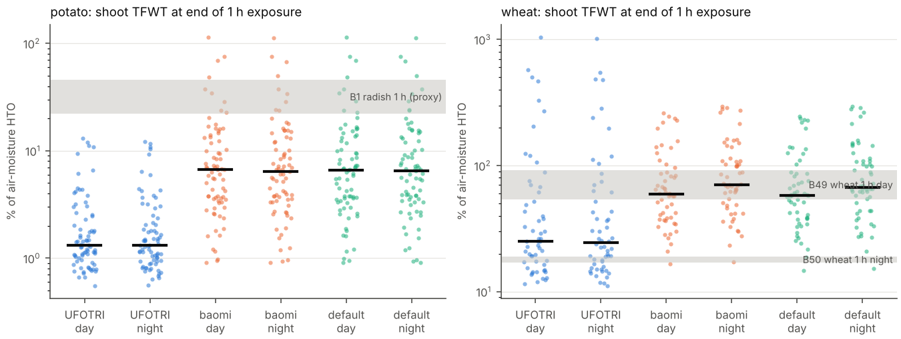
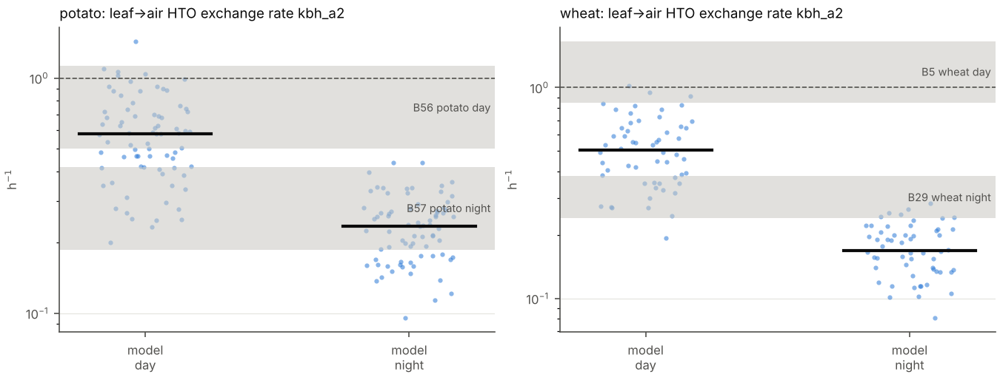
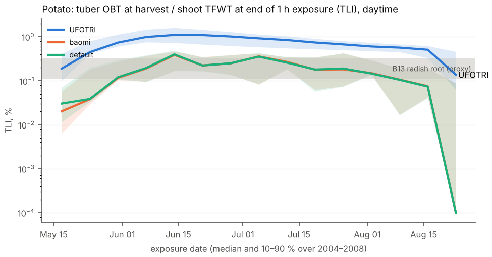
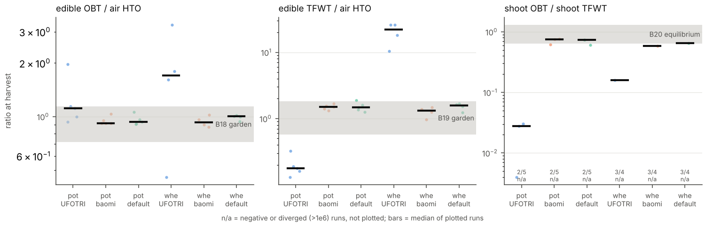

# 模型验证：公开文献数据 × Dmitte HTO 迁移模型

本目录用公开文献中的 HTO 暴露实验结果和公开气象/土壤/作物数据，对 `dmitte` 的空气–土壤–作物
氚迁移模型（`dmitte/transfer_equotions.py` + `dmitte/calc_para.py` + WOFOST）做外部验证。

```
validation/
├── benchmarks/                             # 文献基准 v3：65 条标量基准 + 19 个实验数据集 + 情景卡 + 校准/测试划分（见 benchmarks/README.md）
├── build_inputs.py                         # 从公开数据构建 ./data（气象、土壤、作物参数、农事）
├── run_validation.py                       # 虚拟实验：1 h / 2 h 急性暴露（昼/夜）+ 慢性暴露
├── analyze.py                              # 与文献基准对比，输出表格和图
└── results/                                # 运行结果（CSV、图）
```

## 1 结论速览

本节和第 4 节是**基准 v3**（第 2.1 节）在**第三步修正后**的模型上的结果，**只含校准集**。测试集（15 条）已冻结，
至今没有运行、没有查看（第 3 节第 6 条）。第三步共三处修正（植物水平衡、气孔昼夜变化与风速廓线、OBT 按干物质增长生成），
每一处的单独效果见第 4.1 节。

| 结论 | 依据（校准集，baomi / default） |
|---|---|
| 迁移率全部有限且非负；植物水和果实水的水量平衡闭合 | 负值和非有限值为 0；均匀比活度检验中植物水、果实水的未解释残差为 0（修正前 0.5–160，第 4.2 节） |
| **马铃薯的慢性指标和 TLI 进入文献范围** | 慢性块茎 OBT/空气 0.92（0.72–1.14，B18）；块茎 TFWT/空气 1.5（0.57–1.83，B19）；叶片 OBT/TFWT 0.73–0.75（0.64–1.3，B20）；根茎代理 TLI 0.19 %（0.11–0.33 %，B13）。修正前分别为 16、6.8–12、11–12、6.6 % |
| 白天叶–气交换合理，昼夜差已经出现 | 马铃薯白天 0.58 h⁻¹（0.5–1.1，B56）；小麦白天 0.50 h⁻¹（0.85–1.66，B5，⚠️）；小麦夜/昼吸收比 0.20（0.17–0.38，B4）；昼/夜交换比 7.5–8.7（3–5，B6，⚠️）。修正前昼夜几乎相同 |
| 小麦籽粒 TLI 接近文献 | 0.37–0.39 %（0.18–0.32 %，B26，⚠️）；修正前 0.025–0.065 % |
| **夜间叶–气交换偏慢约 5 倍** | 小麦夜间 0.054 h⁻¹（0.24–0.38，B29）、马铃薯 0.079 h⁻¹（0.19–0.42，B57）；夜间 1 h 吸收 5 %（17–19 %，B50）。夜间气孔阻力 15·RCMIN 偏大（第 5.2 节 1） |
| **暴露结束时叶片 OBT 偏低** | 白天 0.29–0.30 %（0.91–1.59 %，B22），夜间 0.05 %（0.33–0.43 %，B23）。模型没有“新鲜同化物”库（第 5.2 节 2） |
| 白天 1 h 叶片吸收偏低 | 24–25 %（田间箱 54–92 %，B49）；田间箱用风扇通风，空气动力学阻力比模型用的站点风速小（第 5.2 节 3） |

判定数从修正前的 马铃薯 1/0/10、小麦 3/2/9（✅/⚠️/❌，baomi）变为 马铃薯 6/3/2、小麦 2/6/6。
接下来要处理的是夜间阻力（一个参数，可在校准集上标定）和叶片新鲜同化物库（结构改动），之后再运行一次测试集。

## 2 数据

### 2.1 文献基准（`benchmarks/`，v3）

详见 [benchmarks/README.md](benchmarks/README.md)。v3 在 v2 的基础上补读了 5 篇原文
（Diabaté & Strack 1997、Strack et al. 2005、Korolevych & Kim 2013、Shen & Guo 2019、Balashov et al. 2011）：

- `literature_benchmarks.csv`：65 条标量基准，每条带实验类型（舱室/田间箱/温室/田间）、示踪剂、暴露时长、C3/C4 和数据性质（实测/拟合/汇编/参数）；
- `datasets/`：19 个逐次实验数据集，新增小麦舱室逐时序列（空气 HTO、温度、湿度、光照和各器官 TFWT/OBT）和玉米 1 h 暴露；
- `scenario_cards.csv`：15 张情景卡，列出每组实验的暴露条件和缺失项，供用实测条件驱动模型；
- `split.csv`：校准集 50 条、测试集 15 条（小麦舱室、马铃薯舱室、Pickering 慢性）。

马铃薯的直接氚数据只有 FZK 舱室实验（TECDOC-1738 表 24，在测试集）和 Balashov 温室拟合速率常数（在校准集）。

### 2.2 模型输入（`build_inputs.py`，全部公开、固定到 commit）

| 输入 | 来源 |
|---|---|
| 气象 | 荷兰 Wageningen Haarweg 站 2004–2008 逐日数据（Wageningen 大学气象组），取自 [ajwdewit/pcse_notebooks](https://github.com/ajwdewit/pcse_notebooks) `data/meteo/nl1.xlsx` |
| 土壤 | `ec2.soil`（EC2-medium，与原研究同名同参数：SMW 0.099、SMFCF 0.272、SM0 0.39），同上仓库 |
| 作物 | WOFOST 7.2 作物参数 [ajwdewit/WOFOST_crop_parameters@wofost72](https://github.com/ajwdewit/WOFOST_crop_parameters/tree/wofost72)：`Potato_701`、`Winter_wheat_102` |
| 农事 | 生成：马铃薯 5 月 1 日出苗，冬小麦前一年 10 月 20 日播种 |
| `meteo_usefor_cttm.xlsx` 中的派生量 | RH = 水汽压 / 日均温饱和水汽压；气压取标准大气（站点海拔 7 m）；5/10/20 cm 土壤含水量 = 同年马铃薯 WOFOST 根区含水量 SM（无作物期取田间持水量 0.272） |

## 3 方法

1. **虚拟实验**，按文献实验流程设计：
   - *急性*：植物在空气水汽 HTO 浓度恒定的箱中暴露 1 h 或 2 h（田间箱实验为 1 h，舱室实验为 2 h），然后回到洁净空气直到收获。
     整个生长季每周做一次，每次分 11:00（白天）和 23:00（夜间）两组。马铃薯 2004–2008 共 5 季、小麦 2005–2008 共 4 季。
     每次暴露记录开花后天数和所处的灌浆阶段（WOFOST 贮藏器官日增量不低于季节最大值一半的时段为线性灌浆期），
     用于对应 Diabaté & Strack (1997) 按灌浆阶段给出的 TLI。
   - *慢性*：整个生长季空气 HTO 恒定（对应 Korolevych & Kim 的连续释放菜园）。
2. **模型原样使用**：迁移率来自 `transfer_rates`（default，`iaea-case1-HTO.py` 在用）、`transfer_rates_baomi`
   （`potato_HTO.py`、`cereals_HTO.py` 在用）、`transfer_rates_UFORTI`（UFOTRI 常数）；ODE 右端就是
   `transfer_equotions()` 本身。系统对 y 线性、迁移率逐小时分段常数，所以每小时的传播子 = 生成矩阵的矩阵指数，
   生成矩阵从 `transfer_equotions()` 逐列取出（`solve_con()` 现在也用同样的方法，两者结果一致，见 `diagnostics.csv`）。
   唯一的改动是实验施加的边界条件：空气库室在暴露小时内固定为暴露浓度，其余时间为 0（洁净空气）。
3. **昼夜强迫**：仓库的 `meteodata()` 把日数据线性插值到小时，没有昼夜变化。为检验昼夜基准，`run_validation.py`
   用日数据生成逐时强迫（温度在 TMIN/TMAX 间余弦变化、辐射按太阳高度角分配、RH 由逐时温度计算），通过替换
   `calc_para.meteodata` 注入。同时也用仓库原始的逐日插值强迫跑了一遍（结果见 CSV 中 `forcing=daily`）。
4. **浓度换算**：叶片 TFWT = `A_bh / plant_w`（`plant_w` 为活叶片水，第 5.1 节第三步）；块茎/籽粒 TFWT = `A_fh / friut_w`；
   OBT 以燃烧水计，= OBT 库存 / (干物质 × `COMB_WATER` = 0.556 L/kg)（淀粉/纤维素含氢 6.2 %），
   植物 OBT 的干物质为茎叶（TWLV + TWST）；空气水汽量 = `ML × a_h`。
5. **判定**：取模型中位数（全部年份 × 暴露日期，逐时强迫），落在文献范围内为 ✅ 符合；与范围相差 2 倍以内为 ⚠️ 接近
   （TECDOC-1738 §7.9：模型与实验之间的差异至少为 2 倍，实验误差至少 50 %）；超过 2 倍为 ❌ 偏离；
   ≤0 或发散（|log₁₀| > 30）为 ⛔ 非物理。只给中心值的基准按 ×/÷1.5 作为容差。
   每项比较按同作物、同暴露时长对应；没有本作物数据时用代理作物，并在结果中标明。
6. **校准集与测试集**：`benchmarks/split.csv` 把 15 条基准和 4 个数据集划为测试集，按实验活动整体划分：
   FZK 小麦舱室实验（Diabaté & Strack 1997）、FZK 马铃薯舱室实验（TECDOC-1738 表 24）、Pickering 慢性释放。
   除 B12 外它们此前都没有参与过模型对比（B12 在 v1–v2 报告中出现过，属于已知泄漏）。
   `analyze.py` 默认只比较和绘制校准集；测试集的指纹（sha256）记录在 `analyze.py` 中，`tests/test_smoke.py` 检查它没有被改动。
   模型修改全部完成后，用 `python validation/analyze.py --include-test` 运行一次测试集。
   第三步的修正只看了校准集；其中 `OBT_DARK` 取自校准基准 B15 的中值，所以 B15 不再是独立检验。

## 4 结果

完整表见 `results/benchmark_comparison.csv`（含 5–95 % 分位）。下表为校准集各项的模型中位数与判定（第三步修正后）。
“匹配”列：本作物 = 同一作物的实验；代理 = 其他作物（马铃薯用萝卜、小麦用水稻）；通用 = 多作物汇总值。

| 基准 | 作物 | 文献指标 | 实验作物与类型 | 匹配 | UFOTRI | baomi | default | 文献 |
|---|---|---|---|---|---|---|---|---|
| B1 | 马铃薯 | leaf TFWT at end of 1 h exposure / mean air-moisture HTO | radish；field box | 代理 | 6.2 ❌ | 11 ❌ | 11 ❌ | 22–46 % |
| B10 | 马铃薯 | TFWT decrease factor from end of exposure to harvest | radish root；field box | 代理 | 73 ✅ | 12 ✅ | 26 ✅ | 0–1.3×10⁴ - |
| B13 | 马铃薯 | TLI = OBT in root at harvest / leaf TFWT at end of exposure | radish；field box | 代理 | 0.64 ⚠️ | 0.19 ✅ | 0.19 ✅ | 0.11–0.33 % |
| B56 | 马铃薯 | leaf TFWT fast loss rate constant k1 after daytime exposure | potato；greenhouse | 本作物 | 0.35 ⚠️ | 0.58 ✅ | 0.58 ✅ | 0.5–1.1 h-1 |
| B57 | 马铃薯 | leaf TFWT fast loss rate constant k1 after night exposure | potato；greenhouse | 本作物 | 0.35 ✅ | 0.079 ❌ | 0.079 ❌ | 0.19–0.42 h-1 |
| B58 | 马铃薯 | leaf HTO uptake rate constant (day) | potato；greenhouse | 本作物 | 0.35 ❌ | 0.58 ⚠️ | 0.58 ⚠️ | 0.93–2.1 h-1 |
| B6 | 马铃薯 | day/night ratio of leaf HTO uptake rate | most crops (not young lettuce)；review | 通用 | 1 ❌ | 7.5 ⚠️ | 7.5 ⚠️ | 3–5 - |
| B15 | 马铃薯 | night/day ratio of OBT formation at equal leaf HTO | wheat, rice, potato, bean, Chlorella；review | 通用 | 1 ⚠️ | 0.97 ⚠️ | 1 ❌ | 0.1–0.5 - |
| B18 | 马铃薯 | fruit/tuber OBT (Bq/L comb. water) / air HTO (Bq/L) averaged at pod filling | tomato, pepper, potato (pooled)；field | 本作物 | 1.1 ✅ | 0.92 ✅ | 0.93 ✅ | 0.72–1.1 - |
| B19 | 马铃薯 | fruit/tuber HTO / air HTO averaged 3 d before harvest | tomato, pepper, potato (pooled)；field | 本作物 | 0.18 ❌ | 1.5 ✅ | 1.5 ✅ | 0.57–1.8 - |
| B20 | 马铃薯 | plant OBT / plant TFWT at equilibrium (isotopic discrimination factor) | various；review | 通用 | 0.028 ❌ | 0.75 ✅ | 0.73 ✅ | 0.64–1.3 - |
| B4 | 小麦 | night/day ratio of leaf HTO uptake | wheat；field box | 本作物 | 1 ❌ | 0.2 ✅ | 0.2 ✅ | 0.17–0.38 - |
| B49 | 小麦 | leaf TFWT / air-moisture HTO at end of 1 h exposure (day) | wheat；field box | 本作物 | 5 ❌ | 25 ❌ | 24 ❌ | 54–92 % |
| B50 | 小麦 | leaf TFWT / air-moisture HTO at end of 1 h exposure (night) | wheat；field box | 本作物 | 5 ❌ | 5.1 ❌ | 4.9 ❌ | 17–19 % |
| B5 | 小麦 | leaf TFWT loss rate constant within 1 h after daytime exposure | wheat；field box | 本作物 | 0.35 ❌ | 0.5 ⚠️ | 0.5 ⚠️ | 0.85–1.7 h-1 |
| B29 | 小麦 | leaf TFWT loss rate constant within 1 h after night exposure | wheat；field box | 本作物 | 0.35 ✅ | 0.054 ❌ | 0.054 ❌ | 0.24–0.38 h-1 |
| B59 | 小麦 | leaf TFWT fast loss rate constant k1 after daytime exposure | wheat；greenhouse | 本作物 | 0.35 ⚠️ | 0.5 ⚠️ | 0.5 ⚠️ | 0.55–1.2 h-1 |
| B60 | 小麦 | leaf TFWT fast loss rate constant k1 after night exposure | wheat；greenhouse | 本作物 | 0.35 ⚠️ | 0.054 ⚠️ | 0.054 ⚠️ | 0.1–0.22 h-1 |
| B6 | 小麦 | day/night ratio of leaf HTO uptake rate | most crops (not young lettuce)；review | 通用 | 1 ❌ | 8.7 ⚠️ | 8.7 ⚠️ | 3–5 - |
| B22 | 小麦 | leaf OBT (comb. water) / leaf TFWT at end of 1 h exposure (day) | wheat；field box | 本作物 | 0.28 ❌ | 0.29 ❌ | 0.3 ❌ | 0.91–1.6 % |
| B23 | 小麦 | leaf OBT (comb. water) / leaf TFWT at end of 1 h exposure (night) | wheat；field box | 本作物 | 0.052 ❌ | 0.05 ❌ | 0.05 ❌ | 0.33–0.43 % |
| B15 | 小麦 | night/day ratio of OBT formation at equal leaf HTO | wheat, rice, potato, bean, Chlorella；review | 通用 | 0.33 ✅ | 1.2 ❌ | 1.2 ❌ | 0.1–0.5 - |
| B26 | 小麦 | TLI grain (OBT at harvest / leaf TFWT at end of 1 h exposure) | wheat；field box | 本作物 | 0.78 ❌ | 0.37 ⚠️ | 0.39 ⚠️ | 0.18–0.32 % |
| B9 | 小麦 | TFWT decrease factor from end of exposure to harvest | rice；field box | 代理 | 27 ❌ | 1 378 ✅ | 1 189 ✅ | 600–9.5×10⁴ - |
| B20 | 小麦 | plant OBT / plant TFWT at equilibrium (isotopic discrimination factor) | various；review | 通用 | 0.16 ❌ | 0.58 ⚠️ | 0.65 ✅ | 0.64–1.3 - |

判定数（校准集）：

| | ✅ 符合 | ⚠️ 接近 | ❌ 偏离 |
|---|---|---|---|
| 马铃薯 UFOTRI / baomi / default | 3 / 6 / 6 | 3 / 3 / 2 | 5 / 2 / 3 |
| 小麦 UFOTRI / baomi / default | 2 / 2 / 3 | 2 / 6 / 5 | 10 / 6 / 6 |

读表时注意：
- 温室（B56–B60）和舱室实验强制通风，叶–气速率比田间偏高；田间箱实验箱内温度在暴露期间升高约 10 °C（TECDOC-1738 §7.9）。
- UFOTRI 的叶–气交换是常数 0.35 h⁻¹，昼夜相同，它在夜间指标上“符合”只是巧合。UFOTRI 的迁移率本身没有改，
  但它的浓度换算用到 `plant_w`（现在是活叶片水），CEREAL 的 `kbh_bo` 用到 `TROBT`，所以 UFOTRI 的结果也有变化。
- B15 的模型指标是暴露后 24 h 内生成的 OBT（夜间暴露 / 白天暴露，按暴露结束时叶片 HTO 归一化），会把夜间叶片
  HTO 保留到天亮后的光合生成也算进去；夜间交换偏慢时它偏高（第 5.2 节 1）。
- 玉米（B7、B8、B64）是 C4 作物，不用于判定马铃薯和小麦，只作 C4 参照保留在基准表中。

### 4.1 三处修正的逐步效果

每一步都在前一步基础上累加，校准集判定数（✅ / ⚠️ / ❌）：

| 步骤 | 马铃薯 baomi | 马铃薯 default | 小麦 baomi | 小麦 default |
|---|---|---|---|---|
| 修正前（`bad8dc1`） | 1 / 0 / 10 | 1 / 0 / 10 | 3 / 2 / 9 | 3 / 2 / 9 |
| ① 植物水平衡 | 2 / 2 / 7 | 2 / 2 / 7 | 2 / 4 / 8 | 2 / 5 / 7 |
| ② + 风速廓线、气孔昼夜变化 | 3 / 2 / 6 | 3 / 2 / 6 | 2 / 5 / 7 | 2 / 6 / 6 |
| ③ + OBT 按干物质增长生成 | 6 / 3 / 2 | 6 / 2 / 3 | 2 / 6 / 6 | 3 / 5 / 6 |

主要变化（baomi）：
- ① 修正后块茎 TFWT/空气 12.3 → 1.5（B19 ✅）。叶片水改为活叶片水后，小麦叶片水从 0.3 kg/m² 增加到约 1.2 kg/m²，
  白天交换从 1.34 降到 0.21 h⁻¹：修正前小麦交换速率“符合”，是因为叶片水被籽粒干物质比例 0.86 低估了约 4 倍，正好抵消了过大的空气动力学阻力。
- ② 风速廓线修正把 RAM + RB 从约 240 s/m 降到 50–70 s/m；气孔白天按 `RCMIN·RPHO`、夜间按 `15·RCMIN` 取值后，
  马铃薯白天交换 0.58 h⁻¹（B56 ✅），小麦夜/昼吸收比 1.04 → 0.20（B4 ✅），夜间交换降到 0.05–0.08 h⁻¹（偏慢）。
- ③ 慢性块茎 OBT/空气 7.5 → 0.92（B18 ✅），叶片 OBT/TFWT 3.6 → 0.75（B20 ✅），根茎 TLI 1.1 → 0.19 %（B13 ✅），
  小麦籽粒 TLI 0.087 → 0.37 %（B26 ⚠️）；暴露结束时叶片 OBT 从 1.7 % 降到 0.29 %（B22 ❌），夜间降到 0.05 %（B23 ❌）。

各步的完整对比表没有入库；在对应的模型代码上重跑 `run_validation.py` 和 `analyze.py` 即可得到。

### 4.2 均匀比活度检验

`water_balance_residual()`：所有水库室取同一比活度、不计衰变和 OBT、去掉叶片释放中的分馏，计算 dA/dt ÷ A。
水量闭合时它等于水量的相对变化 dlnW/dt；下表为两者之差相对该库室流出速率 k_out 的逐时中位数
（`diagnostics.csv` 中的 `wbabs_*`，越接近 0 越好）：

| 作物 | 变体 | 土壤 1 | 土壤 2 | 土壤 3 | 植物水 | 果实水 |
|---|---|---|---|---|---|---|
| 马铃薯 | UFOTRI | 0.22 | 0.13 | 0.34 | 0.43 | 0.74 |
|  | baomi | 0.66（修正前 0.50） | 0.75（0.47） | 0.94（0.55） | **0**（0.47） | **0**（21） |
|  | default | 0.90（0.87） | 0.48（0.44） | 5.6（2.0） | **0**（0.75） | **0**（14） |
| 小麦 | UFOTRI | 0.26 | 0.22 | 0.54 | 0.47 | 0 |
|  | baomi | 0.62（0.55） | 0.64（0.31） | 0.57（0.47） | **0**（0.90） | **0**（160） |
|  | default | 0.95（0.97） | 0.43（0.42） | 46（23） | **0**（0.66） | 0（0） |

植物水和果实水现在按构造闭合（`plant_water_routes()`，测试 `test_plant_and_fruit_water_balance_closes`）。
土壤三层仍不闭合，default 第 3 层的大值来自达西式（第 5.2 节 4）。






## 5 发现的问题

### 5.1 已修正

**第一步**（单位与索引；回归测试 `tests/test_rate_fixes.py`）：

| 问题 | 修正 | 影响的函数 |
|---|---|---|
| OBT 食入剂量系数写成 4.2e-7 mSv/Bq | ICRP-72 成人值 4.2e-8（HTO 1.8e-8 不变），集中到 `para_constant.DOSE_COEF_OBT/HTO` | 所有剂量脚本，OBT 剂量降为原来的 1/10 |
| Penman–Monteith：`CP = 1.013`、`GAM = 0.67` | `CP = 1013` J/(kg·K)、`GAM = 0.067` kPa/K | `calc_ESOIL`、`calc_ETRM` |
| `ks1_a2 = ESOIL / BODW1`（分母是体积含水率） | 改为第 1 层水量 `soil1w` | default、Korea、baomi、morris |
| `ks3_bh`、`ks3_fh` 分母用了 `soil1w` | 改为 `soil3w` | CEREAL/ROOT_VEG 的全部变体 |
| `kbh_fo = np.log(2/(HWZ/2))`（恒为负、缺 `/24`） | `np.log(2)/(HWZ/2)/24` | default、UFOTRI、Korea 的 CEREAL；TUBER_VEG |
| `HWZ[airfx.sta-1]`（用稳定度索引作物参数，`sta=6` 时 IndexError） | `HWZ[airfx.ICOMP-1]` | 同上 |
| `np.log2(10)` | `np.log(2)` | default、UFOTRI、Korea 的 CEREAL `kbh_fh`；Korea `kbo_bh` |

**第二步**（守恒与非负；测试 `tests/test_conservation.py`）：

| 问题 | 修正 |
|---|---|
| `kbh_so` 从植物库室流出后没有去向（质量泄漏） | 流入土壤第 1 层（`dA_s1_dt` 加 `+ kbh_so·A_bh`）。现在 ODE 只通过三个外部汇损失活度：`ka1_a1`、`ka2_a2`（扩散出混合层）和 `ks3_s3`（深层渗漏） |
| `kbh_bo = TROBT` 在衰老期为负 | 第三步中 `TROBT` 已按干物质增长重写，按构造非负 |
| 达西式 `ks1_s2 = Va_b1/100`、`ks2_s3 = Va_b2/150` 在向上水流时为负 | `_split_darcy()` 拆成两个非负速率：负值部分按相同水通量改为下层 → 上层（加到 `ks2_s1`、`ks3_s2`） |
| 果实/块茎形成前 `friut_w = 0`，`kfh_bh = kbh_fh·plant_w/friut_w` 为 inf | `_assemble()`：果实水为 0 的时刻不向果实迁移，根系吸水全部进入植物水；植物水为 0（出苗前）的时刻进出植物的迁移率都为 0 |
| `iaea-case1-HTO.py` 用 `np.abs(k_array)` 掩盖负值 | 去掉 `abs()`；`solve_con()` 调用 `check_rates()`，遇到负值或非有限值直接报错并列出迁移率名 |
| 没有水量闭合检验 | `water_balance_residual()`：均匀比活度检验，结果写入 `diagnostics.csv`（`wb_*`、`wbabs_*`），见第 4.2 节 |

**review #8：叶–气 HTO 对称交换**：`kbh_a2 = VDPF · ρ_sat / (ALF_HTO · plant_w)`，与吸收项 `ka2_bh = VDPF / ML` 共用总导度
`VDPF = 1/RGES`。吸收通量 g·ρ_v·C_air，释放通量 g·ρ_sat·C_leaf/α，稳态 C_leaf = α·RH·C_air，夜间照常交换。
用于 default、Korea、baomi、morris；UFOTRI 是文献常数，不变。

**第三步**（本次提交；测试 `tests/test_conservation.py`、`tests/test_rate_fixes.py`、`tests/test_smoke.py`）。
default、Korea、baomi、morris 四个变体都改；UFOTRI 的常数不变。

| # | 问题 | 修正 |
|---|---|---|
| ① | 植物水 `plant_w` 用 TAGP 计算，TAGP 含籽粒/块茎，而果实水已单独计入 `friut_w`；含水量用的是贮藏器官的干物质比例（小麦 0.86），叶片水被低估约 4 倍 | `plant_w` = 活叶片水 = TWLV × (LAI / 至今最大 LAI) × 0.8/0.2；叶片含水 80 %（`DMF_LEAF = 0.2`，TECDOC-1991 式 43；Diabaté & Strack 1997）。TWLV 含枯叶，按 LAI 折算 |
| ① | 根系吸水按“大气向植物的沉积通量”计算（`ka2_bh·atm_h·9`），是蒸腾的 2.5–5 倍，多出的水没有出口 | `plant_water_routes()`：根系总吸水 = 净蒸腾 + `kbh_so`·W_bh + d(W_bh + W_fh)/dt。净蒸腾 = g(ρ_sat − ρ_v)，与叶–气交换共用导度，所以植物水按构造闭合（未用 ETRM 或 WOFOST TRA，因为它们和 g 不一致，闭合不了） |
| ① | 果实水：baomi/morris `kfh_bh` 用 `np.maximum(friut_w, 20)` 作下限；default 马铃薯根系向块茎的吸水没有对应流出 | 植物 → 果实液流取各变体原来的 `kbh_fh`·W_bh，果实 → 植物回流取余量，使果实水的净流入等于 dW_fh/dt；下限去掉 |
| ① | `ka2_bh` 的降雨项把雨水整体放进植物水，没有出口，同一份雨水在 `ka2_s1` 中又进入土壤一次 | 降雨不截留在植物上，只进入土壤 |
| ② | **风速廓线**（新发现）：输入是 10 m 风速，`calc_USTERN` 却按 100 m 测量高度外推（`U10·(10/100)^p`），100 m 风速反而小于 10 m；摩擦速度低约 5 倍，RAM + RB ≈ 240 s/m | 测量高度 `ZREF = 10`：`U100 = U10·(100/10)^p`，稳定条件 `U10·(URN/10)^p`；RAM + RB 降到 50–70 s/m。影响土壤沉积 `VDSO`、`ESOIL`、`ETRM` 和叶–气交换 |
| ② | 气孔阻力：`... \| (ISTRE == 1)` 恒为真，RC1 = 15·RCMIN/LAI 昼夜不变；`RGES = RAM + RB + RC1` 把 s/cm 的 RC1 当 s/m 用 | 白天 `RCMIN·RPHO`（`RPHO` 原来已算出但没有用），夜间（PAR < 2 W/m²）和 RH > 98 % 时 `15·RCMIN`；`RGES = RAM + RB + 100·RC1`。原条件中的“有降雨”去掉：逐时降雨是日雨量均分到 24 h，保留它会让每个雨天整天关闭气孔 |
| ③ | `TROBT` 由潜在总同化 − 维持呼吸乘经验系数得到，与植物 HTO 库存的大小无关，昼夜不变；`kbh_fo` 是 ln2/HWZ 的一阶速率，与籽粒/块茎增长无关 | `calc_transOBT()`，TECDOC-1991 式 43：OBT 生成通量 = `ID_OBT`（0.8）× `COMB_WATER` × 干物质增长 × 叶片水比活度。茎叶（`kbh_bo`）按 TWLV + TWST 的增长再加上 `kbo_bh` 周转的补充，使长期暴露下茎叶 OBT/TFWT → 0.8；果实（`kbh_fo`）按 TWSO 的增长。日生成量按逐时辐射分配到白天，夜间为白天平均速率的 `OBT_DARK` = 0.3 倍 |
| — | `solve_con()` 用显式 RK45，籽粒形成初期迁移率可达 10³–10⁴ h⁻¹，与矩阵指数解相差 6–100 %（review #19）；去掉果实水下限后 baomi 也受影响 | 每小时用生成矩阵的矩阵指数（迁移率在一小时内不变时是精确解）；与验证程序的结果一致到机器精度 |

新增参数（`para_constant.py`）：`DMF_LEAF = 0.2`、`ID_OBT = 0.8`、`COMB_WATER = 0.556`、`KBO_BH`（原各变体中的 10 d 半衰期）、
`OBT_DARK = 0.3`。前四个来自文献，没有用基准调过。`OBT_DARK` 的文献范围是 0.1–0.5
（Moses & Calvin：1/3；Thompson & Nelson：0.1；小麦叶片约 0.5，TECDOC-1738 §7.1–7.2），取的是校准基准 B15 的中值。
`ETRM` 现在只用于 default ROOT_VEG 的 `kbh_fh`，`dmitte_morris.py` 对它的扰动基本不再影响结果。

### 5.2 仍未解决（按影响排序）

1. **夜间叶–气交换偏慢约 5 倍**：夜间冠层阻力 15·RCMIN/LAI ≈ 500 s/m（与 TECDOC-1738 表 19 罗马尼亚模型的 690 s/m 同量级），
   但小麦田间箱（B29）、马铃薯和小麦温室（B57、B60）的夜间速率对应的冠层阻力约 100–150 s/m。“15”是唯一需要调整的系数，
   可以在校准集上标定（B29、B57、B60、B50）。它也是 B15 偏高的原因：夜间暴露后叶片 HTO 留到天亮，被白天的光合作用固定。
2. **暴露结束时叶片 OBT 偏低 3–7 倍**（B22、B23）：OBT 生成按净干物质增长 + 周转计算，长期比值正确（B20 ✅）；
   但 1 h 内测到的 OBT 包括刚合成、随后才运出或被呼吸掉的同化物，其速率对应总光合（约每小时 2 % 叶片干重）。
   要同时符合需要一个快速周转的同化物库（`bo → fo` 转运），属于结构改动。
3. **白天 1 h 吸收偏低**（B49：24–25 % vs 54–92 %；B5：0.50 vs 0.85–1.66 h⁻¹）：田间箱用风扇通风，空气动力学阻力比站点风速
   算出的 50–70 s/m 小。按情景卡用实验条件驱动（`scenario_cards.csv`）才能区分这是实验设置还是模型偏差。
4. **土壤水不闭合**（第 4.2 节）：土壤–大气交换不对称（沉积用 `VDSO`、再释放用净蒸发 `ESOIL`），层间达西式（review #7）量纲不自洽。
5. **B15 的指标定义**：基准是“相同叶片 HTO 下的夜/昼 OBT 生成比”，模型指标是 24 h 积分（第 4 节读表说明），混入了夜间交换速率的影响。
   指标是在看结果之前定的，本次没有改。
6. **近似处理**：活叶片按 LAI/至今最大 LAI 折算；籽粒含水整个灌浆期都按收获时的干物质比例 0.86 计算；
   OBT 生成的日内分配只按辐射，不考虑温度和水分胁迫。
7. **仓库中的剂量结果已过期**：`figures/`、`dose_HTO*` 等是修正前的结果，原始站点数据不在仓库中，无法在这里重算。
8. **已修复的可复现性问题**：PCSE 作物参数改从 `wofost72` 分支或 `./data/crop/wofost72` 读取；随仓库提供输出 `PGASS`、`PMRES` 的
   PCSE 配置（`dmitte/conf/Wofost72_WLP_FD_dmitte.conf`）。

## 6 局限

- 部分基准仍来自其他作物（水稻、大豆、萝卜等），只适合判断量级和定性行为（昼夜比、衰减幅度），不适合精细标定。
- 气象是荷兰 Wageningen，不是实验所在地（韩国大田、德国卡尔斯鲁厄、加拿大 Chalk River）；逐时强迫是由日数据合成的，夜间 RH 常被截到 100 %。
- 土壤三层含水量都用 WOFOST 根区 SM，没有分层观测。
- 大气扩散（高斯烟团）部分没有验证：可用的公开示踪实验（如 Prairie Grass）在本环境无法下载。

## 7 复现

```bash
pip install -r requirements-dev.txt          # Python 3.12
python validation/build_inputs.py           # 下载公开数据，生成 ./data（约 1 MB）
python validation/run_validation.py         # 约 1 分钟，写 validation/results/*.csv
python validation/analyze.py                # 对比表 + 图（只含校准集）
python validation/analyze.py --include-test # 只在模型修改全部完成后运行一次：评估冻结的测试集
python -m pytest tests                      # 各步修正的回归测试
```
